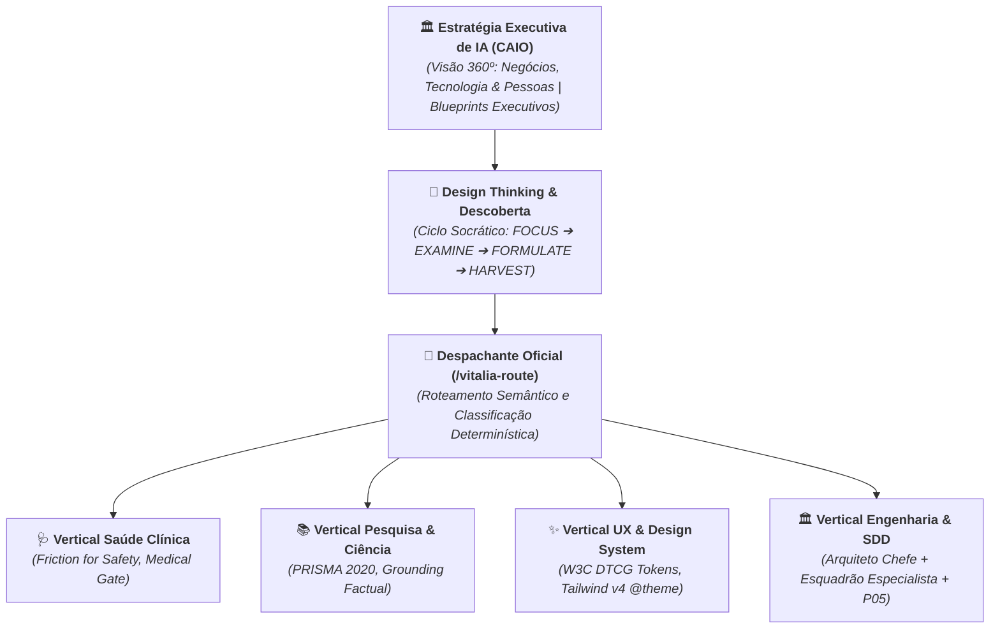

<!-- MEMORANDO DE ARQUITETURA.md | Vitalia Kit v0.0.1 | 23-11-2026 14:15(GMT-04:00) -->
**MEMORANDO DE ARQUITETURA.md | Vitalia Kit v0.0.1 | 23-11-2026 14:15(GMT-04:00)**

# MEMORANDO DE ARQUITETURA E REGISTRO HISTÓRICO DE DECISÕES
## Vitalia Kit v0.0.1 — Da Fábrica de Software à Agência Autônoma Multi-Domínio

---

## 1. Preâmbulo: O Nascimento e a Âncora Histórica do Vitalia Kit v0.0.1

Este documento constitui o **registro arquitetural oficial, âncora de desenvolvimento e mantenedor histórico de decisões** do **Vitalia Kit (v0.0.1)** até a entrega da primeira versão do MVP do novo produto. Ele registra a transição de uma fábrica de software SDD para uma **Agência Agêntica Autônoma Multi-Domínio**, consolidando tanto as fundações herdadas quanto as decisões arquiteturais verificadas por pesquisa P03.

O **Vitalia Kit v0.0.1** nasce sobre uma base limpa de governança, herdando os padrões maduros do ecossistema (Dual-Runtime, OpenAPI 3.0 limpo, §11 Context Lifting sem poda, Memória 3-Tier e Matriz P05), enquanto expande suas capacidades para operar com rigor técnico em múltiplos domínios de negócio, design, ciência, saúde e engenharia.

---

## 2. A Identidade da Agência Multi-Domínio

O **Vitalia Kit v0.0.1** opera como uma **organização agêntica integrada**, projetada para atuação nativa na IDE Google Antigravity, estruturada em torno de verticais interdisciplinares:

1. **Estratégia Executiva de IA & Inovação Corporativa (CAIO):** Visão 360º (Negócios/ROI, Tecnologia/Agentes, Pessoas/Adoção), análise preditiva de cenários corporativos e decomposição de desafios em esteiras de valor.
2. **Design Thinking, Descoberta & Produto:** Ideação universal (Duplo Diamante), formulação de hipóteses, Matrizes CSD/Empatia e proposição de valor com soberania socrática humana.
3. **Saúde Clínica & Segurança do Paciente:** Avaliação de risco clínico, rastreabilidade de biomarcadores, governança de dados sensíveis (LGPD/HIPAA) e o princípio mandatório de *Friction for Safety*.
4. **Engenharia de Software & Spec-Driven Development (SDD):** Pipeline determinístico com auditoria adversarial em múltiplas camadas (`specify` $\rightarrow$ `clarify` $\rightarrow$ `plan` $\rightarrow$ `tasks` $\rightarrow$ `implement` $\rightarrow$ `converge` $\rightarrow$ `judge`), regido pelo Arquiteto Chefe unificado.
5. **Pesquisa Científica & Grounding Factual:** Ingestão de literatura com critérios metodológicos formais (PRISMA 2020), grounding temporal auditável e validação estrita de URLs ativas com status HTTP 200.

---

## 3. Documentação Canônica Unificada

A documentação normativa e os registros de auditoria mantidos neste repositório de apoio e documentação (`vitalia-docs/docs/`) são:

1. 📄 [MEMORANDO DE ARQUITETURA.md](file:///home/andre/projetos/assistidos/vitalia-docs/docs/MEMORANDO%20DE%20ARQUITETURA.md) *(Este documento — Âncora Histórica e Decisória)*
   - Visão estruturante da Agência, invariantes, registro histórico integral de ADRs (`ADR-0001` a `ADR-0014`), rastro temporal das pesquisas P03 e roadmap do MVP.
2. 📄 [CONTRATOS_WORKFLOWS_SDD.md](file:///home/andre/projetos/assistidos/vitalia-docs/docs/CONTRATOS_WORKFLOWS_SDD.md) *(Manual Normativo Mestre Unificado)*
   - Fonte normativa para contratos orientados a *Design by Contract* (DbC): workflows (`.toml`), perfis de guardião (`gp_*.yaml`), modelo de pontuação de ambiguidades (`ambiguity_scoring.yaml` & `src/sdd_ambiguity_scorer.py`), arquitetura de grounding (`grounding_domains.yaml` / `lock.json`), classificador de modos (`architect_modes.yaml` & `src/sdd_architect_mode_classifier.py`), suíte **VRSS** + `vitalia_hook_runner.py` e catálogo de Schemas OpenAPI 3.0 Limpos (`source/src/schemas/`).
3. 📄 [relatorio-completo-testes-e-erros-turno-1.md](file:///home/andre/projetos/assistidos/vitalia-docs/docs/relatorios/relatorio-completo-testes-e-erros-turno-1.md) *(Consolidação de Testes de Prontidão e Auditoria Cruzada — Turno 1)*
   - Registro completo dos testes executados sobre `~/.vitalia-kit/` e `vitalia-kit/source/` e mapeamento integral de defeitos e discrepâncias com `CONTRATOS_WORKFLOWS_SDD.md`.
4. 📄 [handoff-correcoes-vitalia-kit-v0.0.1.md](file:///home/andre/projetos/assistidos/vitalia-docs/docs/handoff-correcoes-vitalia-kit-v0.0.1.md) *(Documento de Transferência para Spec de Correções)*
   - Especificação consolidada de entrada para a próxima spec de correções do Vitalia Kit no repositório de desenvolvimento (`git@github.com:andreticba/vitalia-kit.git`).

> **Nota de Repositório Externo:** O rascunho de brainstorming `RASCUNHO_PORTAO_GROUNDING_P03.md` e o histórico de specs (`specs/001-*` a `specs/005-*`) **não residem em `vitalia-docs`**, pertencendo exclusivamente ao repositório de código do produto (`git@github.com:andreticba/vitalia-kit.git`).

---

## 4. Topologia de Distribuição e Runtime: O Papel de `source/`

Para viabilizar a distribuição limpa e a instalação em novas estações de trabalho, a topologia de engenharia separa o repositório de construção do ambiente instalado no cliente:

### 4.1 Repositório de Desenvolvimento do Kit (`vitalia-kit/`)
- Toda a base de código do produto novo é construída dentro da pasta **`source/`** na raiz deste projeto: módulos centrais e utilitários (`source/src/`), núcleo de dados/contexto (`source/src/core/`), hooks (`source/src/hooks/`), renderizadores (`source/src/rendering/`), sensores VRSS (`source/src/sensors/`), ferramentas auxiliares VRSS (`source/src/tools/`), telemetria (`source/src/telemetry/`), extensões (`source/extensions/`), perfis de governança (`source/profiles/`), schemas (`source/src/schemas/`), templates, integrações e instaladores (`source/kit-bootstrap.sh`, `source/bin/`).
- A pasta `source/` é o artefato de construção, empacotamento e entrega do Vitalia Kit para o repositório na nuvem.

### 4.2 Ambiente Instalado no Projeto Cliente (Topologia Real de 3 Camadas)
Na estação de trabalho de destino do usuário cliente, **a pasta `source/` do kit inexiste**. O bootstrap transfere o kit para a estrutura de 3 Camadas:
1. **Camada 1 — Projeto Cliente (`<project_root>/`):** Código da aplicação (com layout agnóstico, inspecionado dinamicamente), especificações SDD (`specs/`), manifesto `.agents/AGENTS.md` e skills ativas em `.agents/skills/`.
2. **Camada 2 — Kit Global Instalado (`<kit_dir>/`, padrão `~/.vitalia-kit/`):** Runtime isolado em `.venv`, executáveis (`bin/`), perfis (`profiles/`), extensões (`extensions/`) e módulos centrais (`src/`).
3. **Camada 3 — Memória e Governança Local (`<project_root>/.vitalia/`):** Metadados locais (`feature.json`, `pipeline.json`), Memória 3-Tier distribuída (`memory/session/`) e armazenamento operacional (`memory/data_storage/`, incluindo `context/`, `diagnostics/` e `research/`).

---

## 5. Invariantes de Sistema e Decisões Fundamentais

O Vitalia Kit v0.0.1 consolida os seguintes padrões técnicos como invariantes:

1. **Arquitetura Dual-Runtime com Isolamento Estrito:**
   - `{{KIT_PYTHON}}`: Interpretador virtual interno exclusivo do kit (`${VITALIA_KIT_DIR}/.venv/bin/python3`) para **100% dos workflows, hooks, renderizadores, shim `vitalia-clean` e ferramentas do kit**, isolado de dependências do projeto cliente (`inject_venv(project_root)` banido de `kit_env_bootstrap.py`).
   - `{{PROJECT_PYTHON}}`: Interpretador da aplicação cliente descoberto de forma *read-only* para diagnóstico (`project_runtime` no `scan_environment.py`) e reservado exclusivamente para comandos explícitos da *aplicação hospedeira* (`pytest`, linters e builds em `spec-tasks`/`spec-implement`), nunca como padrão para execução do kit.
2. **Elevação Proativa de Sandbox na IDE Antigravity:**
   - Invocação inicial de comandos do kit com `BypassSandbox: true` prescrita no Passo 1 de cada skill.
3. **Governança Constitucional Dinâmica em Camadas (§11 Context Lifting — Estado Real do Código):**
   - A Constituição (`profiles/constitution.yaml`) é compilada deterministicamente via `vitalia_layer_compiler.py` a partir de `source/layers/constitution/base.yaml` + overlays (`overlays/health.yaml`).
   - Em runtime, `GuardianContextV2.build_context()` aplica `resolve_constitution(raw_data, active_gates)` restringindo a poda **exclusivamente aos overlays de domínio da Constituição** conforme `active_domain_gates`, mantendo **Zero Poda** sobre princípios base, `grounding_domains` e demais catálogos (`token_budget: 0`).
   - *(Nota de transição — ADR-0014: os perfis compilados `profiles/gp_*.yaml` atuais adotam o esquema enxuto `mandatory_principles` / `guardrails` / `phase` / `role`, enquanto `GuardianContextV2` ainda lê `phase_guardrails` e `phase_profiles`, resultando em objetos vazios `{}` no envelope até o alinhamento previsto na spec de correções).*
4. **Contratos OpenAPI 3.0 Limpos (Produto Novo Sem Legado `$schema`):**
   - Schemas JSON utilizam campos planos, omitindo `$schema`, `title` de raiz e `additionalProperties: false` para plena interoperabilidade com provedores de Structured Outputs; instâncias runtime (incluindo handoffs) não emitem nem aceitam leitura retroativa de `"$schema"`.
5. **Padrão Afirmativo Canônico:**
   - Diretrizes redigidas de forma assertiva e orientadas ao formato e comportamento desejados, eliminando âncoras negativas em prompts e contratos.
6. **Inviolabilidade do Pipeline SDD (P01) e Matriz de Testes P05:**
   - Toda implementação de código em `source/` ocorre sobre `tasks.md` aprovado e auditado (`specify → plan → tasks → implement → converge`). Todo teste declara sua modalidade (`[TEST:NEW]`, `[TEST:BUGFIX]`, `[TEST:REFACTOR]`, `[TEST:MIGRATION]`) e seu Cenário de Falsificação executável de caixa-preta.
7. **Rastreabilidade Temporal Imutável (P04 — ADR-0014):**
   - Fuso horário rígido `America/Cuiaba (GMT-04:00)` (`DD-MM-YYYY HH:MM(GMT-04:00)`), com versão do produto lida dinamicamente de `<KIT_DIR>/VERSION` no formato `Vitalia Kit v{VERSION}`.
   - Em arquivos Markdown (`.md`), cabeçalho obrigatório em duas linhas: `<!-- nome_arquivo | Vitalia Kit v{VERSION} | DD-MM-YYYY HH:MM(GMT-04:00) -->` na 1ª linha e `**nome_arquivo | Vitalia Kit v{VERSION} | DD-MM-YYYY HH:MM(GMT-04:00)**` na 2ª linha *(sem prefixo `> `)*.
   - Em arquivos `.json`, aplica-se apenas validação sintática (`json.loads`) sem mutação de conteúdo, preservando conformidade com a P11 (OpenAPI 3.0 limpo) e contratos externos. *(Portabilidade do validador `maintenance/header_stamp.py` pendente conforme `ADR-0014`).*
8. **Universalidade e Agnosticismo de Domínio e Layout (P11):**
   - O Kit e seus agentes operam de forma universal sobre qualquer domínio e sobre qualquer estrutura de pastas no projeto cliente.

---

## 6. Registro Histórico de Decisões Arquiteturais (ADRs — Era Vitalia Kit)

### ADR-0001: Fundação do Vitalia Kit v0.0.1 como Agência Multi-Domínio e Topologia `source/`
* **Data:** 12-11-2026 20:41(GMT-04:00)
* **Status:** Aceito (Atualizado em 16-11-2026 quanto à unificação documental)
* **Contexto:** Evolução do antigo Vitalia SPEC Kit para uma solução agêntica multi-domínio apta a empacotamento e distribuição limpa em novas estações de trabalho.
* **Decisões:**
  1. Adoção da identidade **"Vitalia Kit v0.0.1"**.
  2. Adoção da pasta **`source/`** na raiz do repositório de desenvolvimento como origem de empacotamento para a Camada 2.
  3. Consolidação documental em [MEMORANDO DE ARQUITETURA.md](file:///home/andre/projetos/assistidos/vitalia-kit/docs/MEMORANDO%20DE%20ARQUITETURA.md) e [CONTRATOS_WORKFLOWS_SDD.md](file:///home/andre/projetos/assistidos/vitalia-kit/docs/CONTRATOS_WORKFLOWS_SDD.md).

---

### ADR-0002: Reorganização da Pirâmide Agêntica — CAIO, Arquiteto Chefe e Brainstorming Universal
* **Data:** 15-11-2026 16:45(GMT-04:00)
* **Status:** Aceito
* **Contexto:** Dotar a agência de análise executiva corporativa (ROI, riscos, adoção), unificar a liderança técnica e universalizar o brainstorming para qualquer domínio.
* **Decisões:**
  1. Criação do **CAIO Strategist** (`/vitalia-caio`) no ápice da organização (`ENVISION ➔ BENCHMARK ➔ SYNTHESIZE ➔ DECOMPOSE`, emitindo `docs/strategy/BLUEPRINT-<slug>.md`).
  2. Unificação da liderança técnica no **Vitalia Architect & Tech Lead** (`vitalia-architect`), governando modos técnicos, Engenharia Reversa Funcional em 3 Camadas e Matriz P05.
  3. Universalização do `vitalia-brainstorming` (`FOCUS ➔ EXAMINE ➔ FORMULATE ➔ HARVEST`) com turnos socráticos concisos sob soberania humana (HITL).

---

### ADR-0003: Padrão Afirmativo Canônico em Prompts e Contratos
* **Data:** 15-11-2026 16:45(GMT-04:00)
* **Status:** Aceito
* **Contexto:** Mitigar efeitos de *Negation Blindness* e âncoras de atenção reversas em modelos Transformer.
* **Decisões:** Redigir prompts, contratos e guardrails de forma afirmativa, descrevendo formatos desejados, escopos e condições determinísticas de parada.

---

### ADR-0004: Especialização Vertical, Agnosticismo e Padrões SOTA
* **Data:** 15-11-2026 16:45(GMT-04:00)
* **Status:** Aceito (Complementado por ADR-0007)
* **Contexto:** Manter os agentes especialistas universais, agnósticos a projetos passados e ancorados em padrões contemporâneos verificados.
* **Decisões:** Purga de acoplamentos específicos de projetos anteriores e alinhamento das verticais com padrões vigentes (W3C DTCG, Tailwind v4, React 19, WCAG 2.2 AA, Django Ninja/DRF, pgvector HNSW + BM25 RRF, PRISMA 2020, EU AI Act Art. 14).

---

### ADR-0005: Unificação Canônica dos Contratos e Guardian Profiles (`gp_*.yaml`)
* **Data:** 15-11-2026 17:30(GMT-04:00)
* **Status:** Aceito (Evoluído por ADR-0008 quanto à geração em camadas)
* **Contexto:** Eliminar fragmentação contratual entre workflows, especialistas e extensões.
* **Decisões:** Unificação integral em [CONTRATOS_WORKFLOWS_SDD.md](file:///home/andre/projetos/assistidos/vitalia-kit/docs/CONTRATOS_WORKFLOWS_SDD.md), formalização dos perfis `gp_*.yaml` sem poda (`no_prune: true`) e calibração de `ambiguity_scoring.yaml` para todas as verticais.

---

### ADR-0006: Classificador Determinístico de Modos do Architect e Triage Gate HITL
* **Data:** 15-11-2026 18:35(GMT-04:00)
* **Status:** Evoluído por ADR-0010
* **Contexto:** Retirar a classificação de modo técnico do Brainstorming e da intuição pura do LLM, suportando invocação direta via `/vitalia-architect`.
* **Decisões Originais:** Criação de `sdd_architect_mode_classifier.py`, `architect_modes.yaml` e Triage Gate HITL no Passo 1 do Architect. *(A modelagem interna dos modos, o scoring e a localização dos diagnósticos foram evoluídos pelo ADR-0010).*

---

### ADR-0007: Protocolo P03 Estrito — Remoção de `self` em Pesquisas e Evidência Auditável na Camada 3
* **Data:** 16-11-2026 11:26(GMT-04:00) *(Marco histórico no kit legado ativo em 16-11-2026; consolidado para `~/.vitalia-kit/` e `source/` nos ADRs ADR-0012 e ADR-0013)*
* **Status:** Aceito e Evoluído *(Aplicado originalmente em `~/.vitalia-spec-kit/extensions/research.toml` e `AGENTS.md` em 16-11-2026; migrado integralmente para `source/` via ADR-0012/ADR-0013)*
* **Contexto:** Durante a sessão de 16-11-2026, sub-agentes invocados via `self` com prompt livre pularam a validação `curl` HTTP 200 e a leitura integral de fontes, produzindo sínteses sem rastro verificável.
* **Decisões:**
  1. **Remoção imediata de `self` no fluxo de pesquisa:** Toda busca web ou verificação externa utiliza exclusivamente `define_subagent` criando `vitalia-researcher` com `EnableWriteTools: true` e o protocolo integral de grounding no `SystemPrompt`.
  2. **Reforço global no `AGENTS.md` do Kit:** Inclusão da diretriz permanente de pesquisa exclusiva via `vitalia-researcher` e evidência obrigatória.
  3. **Evidência auditável na Camada 3:** Toda fonte consultada gera registro em `.vitalia/memory/data_storage/research/<tema>/` (`evidence.jsonl` com URL final, status HTTP 200, SHA-256, timestamp GMT-04:00; `snapshots/` com texto integral; e conferência literal de citação).
  4. **Portão determinístico (`vitalia_grounding_validator.py`):** Implementação planejada em `source/src/` (`source/src/vitalia_grounding_validator.py`) para bloquear consolidação de relatórios sem evidência HTTP 200, hash e citação confirmada.
* **Consequências:** Transforma o P03 de recomendação textual em barreira verificável e auditável.

---

### ADR-0008: Núcleo Universal + Extensões e Poda por Domínio (Arquitetura em Camadas)
* **Data:** 16-11-2026 15:42(GMT-04:00)
* **Status:** Aceito
* **Contexto:** A Constituição atual, o catálogo `grounding_domains.yaml`, os perfis `gp_*.yaml` e os `.toml` misturam regras universais com particularidades de saúde clínica ou stacks específicas (Django, Next.js, Ollama), gerando vazamento de domínio, alto custo de manutenção e diluição de atenção em projetos de outras verticais.
* **Decisões:**
  1. **Núcleo Constitucional Universal + Extensões por Domínio:** Refatorar `constitution.yaml` em núcleo universal (sempre ativo) e extensões setoriais (saúde clínica, regulação etc.) ativadas via `domain_gates` e `domain_detector`.
  2. **Composição Declarativa em Camadas (`base` + `overlays`/`extends`):** Manter fontes declarativas separadas (base universal + overlay de domínio + override por workflow) compiladas deterministicamente para os arquivos `.toml` e `gp_*.yaml` consumidos pelo runtime, mantendo 100% de compatibilidade com `vitalia_hook_runner.py` e adicionando verificação automatizada de deriva em testes.
* **Consequências:** Viabiliza o crescimento multi-vertical do Vitalia Kit sem duplicação manual nem contaminação de domínios.

---

### ADR-0009: Evolução de `grounding_domains.yaml` e Lockfile de Proveniência (`grounding_domains.lock.json`)
* **Data:** 16-11-2026 15:42(GMT-04:00)
* **Status:** Aceito *(Fundamentado em `.vitalia/memory/data_storage/research/grounding-domains/relatorio.md`)*
* **Contexto:** O catálogo atual mistura detalhes de stack específica, usa janela fixa única (`90` dias), armazena strings simples de URL e mistura política declarativa com metadados voláteis de verificação.
* **Decisões:**
  1. **Manter e evoluir o catálogo temático em camadas (`base` + `overlays`/`extends`):** Não substituir por mera allowlist de hostnames; isolar stacks específicas em pacotes opcionais.
  2. **Fontes estruturadas e Tiers de Confiança:** Converter `authoritative_sources` em objetos (`url`, `source_tier`, `source_type`, `authority_scope`, `volatility`) alinhados a W3C PROV (`prov:hadPrimarySource`) e OWASP LLM08:2025.
  3. **Política de frescor em dois relógios + volatilidade por fonte:** Separar o relógio HTTP (`ETag`/`If-None-Match` → `304`, `Deprecation` RFC 9745, `Sunset` RFC 8594) do relógio semântico (`valid_until`, `last_verified_at`, `sha256`).
  4. **Fontes estruturadas e lock gerado:** Suportar `/llms.txt` v2 e APIs de release com `digest`; isolar estado volátil gerado em `grounding_domains.lock.json` (`prov:Bundle`).
  5. **Citação forense e schema limpo:** Exigir `snapshot_ref`, `sha256` e `literal_quote` conferida (mitigando *post-rationalization*), sob schema OpenAPI 3.0 limpo.
* **Consequências:** Desacopla curadoria humana de estado de máquina e combate alucinação de citações com evidência reproduzível.

---

### ADR-0010: Refatoração de `architect_modes.yaml` (Opção D + `concern` leve + RRF e Fallback)
* **Data:** 16-11-2026 15:42(GMT-04:00) *(Substitui parcialmente o ADR-0006)*
* **Status:** Aceito *(Fundamentado em `.vitalia/memory/data_storage/research/architect-modes/relatorio.md`)*
* **Contexto:** A lista plana inicial de modos misturava atividades (*refatoração*), atributos de qualidade (*tuning*) e domínios tecnológicos (*kernel/driver*, *offloading*), usava soma linear bruta de sinais heterogêneos, acoplava-se a `source/`/`tests/` no cliente e não previa fallback de baixa confiança.
* **Decisões:**
  1. **Núcleo Mínimo Agnóstico + Perfis via `extends` e `file_triggers` (Opção D):** Manter no núcleo apenas modos operacionais universais e carregar especializações de nicho sob demanda.
  2. **Separação leve de `concern`:** Distinguir atividade/postura de atributo de qualidade/risco (ISO/IEC 25010, Well-Architected, STRIDE, SRE).
  3. **Fusão por Posto (RRF) e Fallback Explícito:** Substituir soma linear bruta por **Reciprocal Rank Fusion (`1 / (k + rank)`)** ou normalização com desempate determinístico; renormalizar sinais ausentes sem penalização; adotar estado explícito de baixa confiança / desambiguação em dois estágios antes do Triage Gate HITL.
  4. **Agnosticismo e Camada 3:** Remover `source/`/`tests/` fixos para projetos clientes e gravar diagnósticos em `.vitalia/memory/data_storage/diagnostics/architect_mode_diagnostics.json`.
  5. **Reserva do `vitalia-architect`:** Manter o agente em reserva até a implementação de `architect_modes.yaml` e `sdd_architect_mode_classifier.py`.
* **Consequências:** Elimina colisões de nicho, evita vencedores espúrios no Triage Gate e torna o classificador aplicável a qualquer vertical.

---

### ADR-0011: Acoplamento via `vitalia_hook_runner.py` (Sem Hooks da IDE) e Arquitetura-Alvo VRSS em 4 Ondas
* **Data:** 16-11-2026 15:42(GMT-04:00) *(Fundamentado em `.vitalia/memory/data_storage/research/hooks-antigravity/relatorio.md` e `vrss-sensores/relatorio.md`)*
* **Status:** Aceito
* **Contexto:** Embora a IDE Antigravity ofereça `.agents/hooks.json`, optou-se por manter o controle explícito e portável do kit via `vitalia_hook_runner.py`. Simultaneamente, a auditoria dos sensores atuais em `src/sensors/` revelou bugs críticos (`sensor_tokens_leak.py` com regex `sk_[live|test]_` usando classe de caracteres e varrendo só `*.json`; `sensor_memory_ledger.py` comparando datas `DD-MM-YYYY` lexicograficamente) e ausência de registro, severidades, política `fail-open`/`fail-closed` e pipeline anti-ruído real.
* **Decisões:**
  1. **Topologia de 4 pontos de acoplamento:** `vitalia_hook_runner.py` (`--phase before|after`) como portão de workflow + wrapper `vrss_exec` para comandos de teste/build no turno + git hooks locais (`pre-commit`/`pre-push`) + CI.
  2. **Evolução do `vitalia_hook_runner.py`:** `--phase after` enxuto (sem reconstruir payload Guardian de entrada), agregação de envelopes `Finding` JSON com severidades e `fail-open`/`fail-closed`, remoção de `shell=True`, remoção de fallbacks hardcoded de modelo e duplicação de `prompt`, resolução de `extends`/`domain_gates`, escrita atômica e `--help` didático.
  3. **Implantação do VRSS em 4 Ondas:**
     - *Onda 1:* Correção dos bugs de `sensor_tokens_leak.py` e `sensor_memory_ledger.py`, registro único, schema `Finding` JSON e evolução do `vitalia_hook_runner.py`.
     - *Onda 2:* Wrapper `vrss_exec` (captura/redação → slicing determinístico → Context Lifting §11 → envelope JSON) e `StuckDetector` semântico (hash normalizado + verificação de progresso real).
     - *Onda 3:* Monitor de saturação/condensação de contexto, *Spotlighting*, separação de capacidades (*CaMeL*), guarda *Lethal Trifecta* e `detect-secrets` no `pre-commit`.
     - *Onda 4:* `mutmut` restrito ao delta do `git diff` em CI, `Hypothesis` nos contratos DbC e telemetria compatível com OpenTelemetry GenAI.
* **Consequências:** Eleva a observabilidade e segurança em malha fechada sem acoplar o kit a hooks proprietários da IDE.

---

### ADR-0012: Portão Obrigatório de Grounding P03 Autocontido, Defesa Universal em 5 Camadas, Saúde de Sessão Spec 007, Isolamento Dual-Runtime `{{KIT_PYTHON}}` e Consolidação Full-Stack em `source/`
* **Data:** 18-11-2026 17:02(GMT-04:00) *(Consolidado após revisão integral com inclusão do Spec 007 `vitalia-clean`, runtime `{{KIT_PYTHON}}` exclusivo, Defesa P03 nos 33 workflows sem `search_web`, curadoria global/local no `GroundingDomainUpdater` e desenvolvimento focado exclusivamente em `source/`)*
* **Status:** Aceito *(Refinado em 19-11-2026 pelo ADR-0013 conforme [specs/005-portao-grounding-p03/plan.md](file:///home/andre/projetos/assistidos/vitalia-kit/specs/005-portao-grounding-p03/plan.md))*
* **Contexto:** Workflows sem `search_web` direto ou com acesso irrestrito podiam desviar do fluxo auditável do `vitalia-researcher`. Além disso, o kit legado em `~/.vitalia-spec-kit/` chamava `inject_venv(project_root)` no `kit_env_bootstrap.py` (misturando dependências do projeto cliente no processo do kit) e usava `exec python3` em `bin/vitalia-clean`, enquanto os schemas OpenAPI 3.0 Limpos exigem ausência total de `"$schema"` sem suporte retroativo a handoffs antigos.
* **Decisões:**
  1. **Fluxo Autocontido de 8 Passos do `vitalia-researcher` (SRP):** Recepção e criação de `.vitalia/memory/data_storage/research/<tema>/` $\rightarrow$ classificação contra `grounding_domains.yaml` (ou marcação `general_web` sem modificar o YAML global) $\rightarrow$ cache de 90 dias (`default_validity_days`) $\rightarrow$ coleta HTTP 200 com `snapshots/<sha256_prefix>.txt`, `urls.txt` e `evidence.jsonl` $\rightarrow$ portão interno *fail-closed* (`vitalia_grounding_validator.py --mode evidence` com política D18: *Retry+Degrade* default, *HITL Escalation* para `clinical_safety`/`regulations_compliance`, *Hard Block* com `--strict`) $\rightarrow$ renderização determinística de `GROUNDING_AUDIT.md` via `rendering/grounding_audit_renderer.py` + `templates/grounding_audit_template.md` $\rightarrow$ handoff reverso (`vitalia_handoff.py create --direction reverse` sem `$schema`) $\rightarrow$ exibição do relatório com links clicáveis.
  2. **Estratégia de Defesa Universal em 5 Camadas (33 Workflows) e Regra de Dois Mundos:** Remoção de `search_web` de `tools.optional` em `source/layers/extensions/*.toml` nos **33 workflows que operam sem `search_web`** (15 centrais excluindo `research.toml`, 10 agentes especialistas e 8 extensões de suporte), mantendo `define_subagent`/`invoke_subagent` habilitados, cláusula afirmativa exclusiva nos prompts (ADR-0003), checklist pré-síntese, portão determinístico interno ao `vitalia-researcher`, e `search_web` exclusivamente em `research.toml` e em chat livre sem workflow ativo (ou sob Override HITL explícito do usuário). Inclusão de 6 novos domínios em `grounding_domains.yaml` (`web_frameworks`, `devops_ci`, `cloud_services`, `design_patterns`, `javascript_ecosystem`, `general_web`).
  3. **Arquitetura SRP do Grupo 3, Produto Novo Sem `$schema`, Motor de Domínios na Máquina & Navegação `.md` em 2 Níveis (`data_storage/`):** Extração de `core/data_storage_io.py` (Zero Data Leak, validação OpenAPI 3.0 limpa, atualização de ledgers `<categoria>/index.jsonl` e renderização de visões Nível 2 `<item>.md` com badges `shields.io`), `vitalia_handoff.py` (zero emissão e zero leitura retroativa de `$schema`, `ttl_seconds = 86400`, transição atômica para `status: "expired"`), `DataStorageDashboardRenderer` (leitura direta exclusivamente dos `.jsonl` para gerar `.vitalia/memory/data_storage/README.md` [Nível 0] e `<categoria>/README.md` [Nível 1] com links clicáveis para `<item>.md` [Nível 2]), `GroundingDomainUpdater` (leitura direta de `.vitalia/memory/data_storage/research/*/evidence.jsonl` no `session-consolidate` para listar pendentes `general_web`, validação *fail-closed* `exit 1` de `.vitalia/grounding_decisions_payload.json` com objetos tipados e atualização exclusiva do Motor de Domínios local na máquina em `grounding_domains.yaml`/`layers/grounding/` com `scope: global | domain_overlay | local` e campo opcional `project`, sem lógica de sync de motor na nuvem), `GroundingRenderer` (projeção do Motor de Domínios atualizado da máquina + decisões HITL em `.vitalia/memory/session/data/grounding-domains.jsonl` e `.vitalia/memory/session/GROUNDING_DOMAINS.md` com tabelas Globais, Domain Overlays e Locais + badges, aposentando `.vitalia/memory/session/grounding-domains-local.yaml`), `DashboardRenderer` & `ViewRenderer` lendo diretamente `.vitalia/memory/session/data/*.jsonl` (exibindo domínios globais, overlays e locais no `session/README.md`), flags independentes em `vitalia_context_engine.py`, preservação integral da Spec 007 em `vitalia_tmp_cleanup.py` + `source/bin/vitalia-clean` via `{{KIT_PYTHON}}` (menu `[a/d/n/t]`, proteção de `📅 hoje`, parser `1,2`/`1-3`, confirmação `[s/N]`, `--dry-run`/`--force`/`--purge-all`/`--target-dir`/`--help`, sonda `os.scandir` `< 50ms` em `scan_environment.py` contando apenas envelopes `.json` com `needs_cleanup: eligible_files >= 10 || eligible_bytes >= 1048576` em `context_cleanup.schema.json` e remoção sincronizada do par `.json` + visão `.md` + ressincronização de `index.jsonl` e `README.md`) expandida com `--types` (`context`, `handoffs`, `diagnostics`, `telemetry`, `research`, `backups`, `all`) e `--keep-backups 5`, além de `sdd_ambiguity_scorer.py` completo.
  4. **Regra Soberana de Configuração e Runtime Padrão `{{KIT_PYTHON}}`:** O arquivo `.env` do projeto cliente **nunca** armazena nem é consultado para identificar `SESSION_REPO`, `DATA_REPO`, `VITALIA_KIT_DIR` ou `kit_dir`. `SESSION_REPO` e `DATA_REPO` residem exclusivamente em `.vitalia/config.yml` (`memory.session_repo` e `memory.data_repo`), enquanto `VITALIA_KIT_DIR` / `kit_dir` é resolvido exclusivamente por `kit_env_bootstrap.py`. Todo workflow, hook, renderer e `source/bin/vitalia-clean` roda exclusivamente em `{{KIT_PYTHON}}` (`inject_venv(project_root)` removido de `kit_env_bootstrap.py`); `find_project_python()` é exclusivamente *read-only* para diagnóstico e comandos de testes da aplicação cliente.
  5. **Instaladores Limpos e Reinstalação Idempotente (Sem Gemini CLI):** Inclusão de `kit-bootstrap.sh`, `requirements.txt`, `source/AGENTS.md` (5 diretrizes afirmativas com Pesquisa P03 via `vitalia-researcher`), `source/bin/install-project` (remoção integral da opção Gemini CLI + arquivo de legados `.gemini/commands/vitalia.*`), `source/bin/vitalia-clean` (invocando `{{KIT_PYTHON}}`), `source/bin/lib/*.sh` e `source/integrations/antigravity/SKILL.md.template`, com validação de `vitalia_layer_compiler.py --check`, checagem/recriação de `.venv` corrompido, escrita exclusiva de `.vitalia/config.yml` e leitura via `tomllib` no gerador de skills. Desenvolvimentos e testes automatizados deste repositório tocam exclusivamente `source/` e diretórios temporários isolados.
* **Consequências:** Fecha todas as lacunas entre `source/` e o ambiente instalado em máquina limpa (`~/.vitalia-kit/`), isola 100% o runtime do kit em `{{KIT_PYTHON}}`, unifica Spec 007 ao faxineiro multi-categoria com sincronismo de visões `.md`/`.jsonl`, elimina código legado `$schema`/`inject_venv`, garante que o Motor de Domínios seja atualizado exclusivamente na máquina antes de projetar os dados para o dashboard na nuvem (sem `grounding-domains-local.yaml`), oferece navegação `.md` amigável em 2 níveis sobre `.vitalia/memory/data_storage/` e assegura governança P03 em todos os 33 workflows sem `search_web`.

---

### ADR-0013: Alinhamento Técnico do Planejamento `005-portao-grounding-p03` (OAS 3.0.3, Escopos `global`/`domain_overlay`/`local`, Ordem `.venv` $\rightarrow$ `--check` & Unificação Determinística)
* **Data:** 19-11-2026 07:45(GMT-04:00) *(Consolidado após auditorias `/vitalia-judge --mode=plan` e homologação arquitetural de [specs/005-portao-grounding-p03/plan.md](file:///home/andre/projetos/assistidos/vitalia-kit/specs/005-portao-grounding-p03/plan.md))*
* **Status:** Aceito
* **Contexto:** Durante o planejamento formal e a inspeção constitucional adversarial da Entrega 5, verificou-se que: (a) OpenAPI 3.0.3 Sec. `4.7.24` veda `"type": ["string", "null"]` e tipo `"null"`; (b) o catálogo compilado `grounding_domains.yaml` combina domínios `global` e `domain_overlay` (com atributo `gate`), exigindo projeção fiel pelo `GroundingRenderer` e Schema `#10` sem `minItems: 1` rígido para não bloquear `general_web`/`rejected`; (c) em máquina limpa sem `PyYAML` global, `source/kit-bootstrap.sh` precisa provisionar `.venv` + bibliotecas antes de rodar `vitalia_layer_compiler.py --check` e antes da cópia do runtime; e (d) havia drift entre caminhos legados em `CONTRATOS_WORKFLOWS_SDD.md` (`src/tools/sdd_*.py`, `ambiguity_taxonomy_schema.json`) e o runtime real em `source/src/`.
* **Decisões:**
  1. **Schema `#10` (`grounding_decision.schema.json`) Estrito OAS 3.0.3 & Papéis de Escopo (`global`, `domain_overlay`, `local`, `rejected`):** `scope` é campo opcional `"type": "string"` com `enum: ["global", "domain_overlay", "local", "rejected"]` (omitido quando indefinido, rejeitando `"scope": null`), e `authoritative_sources` permanece sem `minItems: 1` rígido no JSON Schema. O `GroundingDomainUpdater` aceita ingestão HITL restrita a `{"global", "local", "rejected"}` exigindo `name`, `trigger` e `>= 1` objeto tipado completo em `authoritative_sources` para `global`/`local`; já o `GroundingRenderer` lê todo o Motor da máquina + decisões e projeta os `4` escopos em `session/data/grounding-domains.jsonl` + `session/GROUNDING_DOMAINS.md` (tabelas Globais, Domain Overlays com `gate` e Locais do Projeto).
  2. **Schema `#01` (`context-lifting-envelope.schema.json`), `GuardianContextV2` & `session-start.toml`:** Ambos `meta.hardware_profile` e `guardian.hardware_profile` aceitam `["frontier", "lightweight"]` (dado que `vitalia_hook_runner.py` espelha o valor de `meta` em `guardian`), `meta.model_profile` aceita `["flash", "pro", "frontier"]`, `guardian_json.env_summary.context_cleanup` declara os `4` campos planos de `context_cleanup.schema.json` populados por `GuardianContextV2._load_env_summary()` (zero listas de arquivos), e `session-start.toml` herda `hooks.before = ["{{KIT_PYTHON}} {{VITALIA_KIT_DIR}}/src/hooks/scan_environment.py"]` (com exit `0` mesmo sem `.env` no cliente).
  3. **Ordem de Execução Limpa do `source/kit-bootstrap.sh` & Instaladores:** `(1)` Preflight (`Python >= 3.11`, `venv`, `git`, escrita) $\rightarrow$ `(2)` criação/recuperação inicial de `${KIT_DIR}/.venv` e instalação de `source/requirements.txt` $\rightarrow$ `(3)` gate *fail-closed* `vitalia_layer_compiler.py --check` via `"${VENV_DIR}/bin/python3"` *(antes da cópia do runtime)* $\rightarrow$ `(4)` cópia estrita do runtime preservando `.venv/` e excluindo `layers/`/`tests/` $\rightarrow$ `(5)` criação dos shims `vitalia-install-project`/`vitalia-clean` e atualização idempotente de shell rc. No `install-project`: merge não-destrutivo de `.vitalia/config.yml` existente e geração das `34` skills integralmente em `{{KIT_PYTHON}}` + `tomllib` (zero `sed`).
  4. **Alinhamento de Caminhos, Unidades `--types`, `resolve_kit_dir` & Zero Data Leak:** Padronização de `architect.toml`/`clarify.toml`/`gp_sdd-judge.yaml` para `src/sdd_architect_mode_classifier.py`, `src/sdd_ambiguity_scorer.py` e `ambiguity_taxonomy.schema.json`; unidades físicas explícitas em `vitalia_tmp_cleanup.py --types` (`context`/`handoffs`/`diagnostics` em par `.json`+`.md`, `research/<tema>/` protegido `< 90d`, `backups` `*.bak.*` + `legacy-gemini-*` com `--keep-backups 5`, `telemetry`) + `resync_category_index()` verificando `(category_dir / entry["json_path"]).exists()`; `resolve_kit_dir` checando `(Path.home() / ".vitalia-kit").exists()` antes do fallback `script_kit_root`; leitura estritamente *read-only* de `PROJECT_VENV_PATH` sem mutar `os.environ`; e guarda Zero Data Leak preservando fixtures isolados em `tmp_path` (`test_vitalia_hook_runner.py`).
  5. **Alinhamento Canônico de `domain_gates` (Opção A) & `resolve_active_gates()` Restrito à Constituição:** Em `CONTRATOS_WORKFLOWS_SDD.md`, `medical-gate.toml` é padronizado para `domain_gates = ["health"]` (em paridade com `constitution/overlays/health.yaml`, `source/layers/extensions/medical-gate.toml`, `agents_catalog.yaml` e `test_entrega4_onda4.py`), removendo gates sem overlay constitucional (`corporate_strategy`, `scientific_claims`, `provedores_de_ia`) para `domain_gates = []`. No runtime, `vitalia_hook_runner.py` implementa `resolve_active_gates(data, cwd)` compondo `sorted(set(workflow.meta.domain_gates) | set(config_yml.domain_gates))` (via `kit_env_bootstrap.read_project_config()`, degradando com segurança para `[]` quando ausente/inválido e sem consultar `.env`) e repassa `active_gates` ao `GuardianContextV2` para aplicação **exclusiva** em `resolve_constitution()` (expondo `guardian_json.active_domain_gates` e preservando `meta.domain_gates` intacto), mantendo **Zero Poda** em `grounding_domains.yaml` para preservar detecção transversal P09/D18 e simetria com `vitalia-researcher`.
* **Consequências:** Garante instalação reproduzível em máquina limpa sem pacotes globais, conformidade estrita OAS 3.0.3 / `jsonschema 4.26.0`, ativação setorial coerente de overlays constitucionais por projeto (`.vitalia/config.yml`) sem pontos cegos no grounding, rastreabilidade visual de overlays (`gate`) no painel de grounding e paridade 1:1 entre `docs/`, `specs/005-portao-grounding-p03/` e a implementação em `source/`.

---

### ADR-0014: Estado Real da Governança Dinâmica (§11), Padronização P04 (`Vitalia Kit v{VERSION}`) e Reconciliação Pós-Auditoria do MVP
* **Data:** 23-11-2026 14:15(GMT-04:00) *(Consolidado após auditoria de prontidão do Turno 1 sobre `~/.vitalia-kit/` e `vitalia-kit/source/`)*
* **Status:** Proposto para Spec de Correções (Baseado em [relatorio-completo-testes-e-erros-turno-1.md](file:///home/andre/projetos/assistidos/vitalia-docs/docs/relatorios/relatorio-completo-testes-e-erros-turno-1.md) e [handoff-correcoes-vitalia-kit-v0.0.1.md](file:///home/andre/projetos/assistidos/vitalia-docs/docs/handoff-correcoes-vitalia-kit-v0.0.1.md))
* **Contexto:** Os testes de prontidão sobre o primeiro MVP instalado (`~/.vitalia-kit/`) e o código-fonte (`vitalia-kit/source/`) revelaram que: (a) os perfis `gp_*.yaml` compilados em camadas passaram a usar `mandatory_principles`/`guardrails`/`phase`/`role`, deixando `phase_guardrails` e `phase_profiles` vazios (`{}`) em `GuardianContextV2`; (b) a regra P04 foi resumida em `constitution.yaml` e seu validador `maintenance/header_stamp.py` (assim como `hooks/llm_judge.py`) inexiste em `source/src/`; (c) os `34` arquivos `.toml` carregam apenas prompts resumidos (64–115 chars) frente aos contratos completos de `CONTRATOS_WORKFLOWS_SDD.md`, e módulos do `T028` (`core/context_engine.py`, `core/shard_manager.py`, `rendering/view_renderer.py`, `constitution_renderer.py`) ainda não existem em `source/src/`; e (d) remanesce split-brain de caminhos `.vitalia/session/data/` vs `.vitalia/memory/data_storage/`.
* **Decisões:**
  1. **Formalização da Poda Restrita e Alinhamento de `GuardianContextV2`:** Registrar que `resolve_constitution()` aplica poda por `active_domain_gates` apenas aos overlays da Constituição (mantendo base, `grounding_domains` e catálogos integrais com `token_budget = 0`), e alinhar `GuardianContextV2` ao esquema real dos `gp_*.yaml` (ou restaurar `phase_guardrails`/`phase_profiles` via `gp_base.yaml` + `layers/profiles/`).
  2. **Padronização Canônica da P04 e Portabilidade do `header_stamp.py`:** Identidade única **`Vitalia Kit v{VERSION}`** lida dinamicamente de `<KIT_DIR>/VERSION`; 2ª linha de `.md` em negrito puro `**<arquivo> | Vitalia Kit v{VERSION} | <ts>**` *(sem `> `)*; tratamento de `.json` estritamente via validação sintática (`json.loads`, zero mutação) para compatibilidade P11 OpenAPI 3.0 limpo; e restauração da regra P04 integral em `constitution.yaml` com portabilidade atualizada de `kit_src/source/src/maintenance/header_stamp.py`.
  3. **Separação Limpa de Camada 3 e Novos Papéis de Revisão:** Consolidar `.vitalia/memory/session/` (`session_repo`) e `.vitalia/memory/data_storage/` (`data_repo`) como repositórios independentes com dashboards próprios em nuvem; especializar `science-review.toml` (revisor metodológico apoiado por `vitalia_grounding_validator.py`) e `integrative-review.toml` (síntese cruzada), mantendo `vitalia-researcher` obrigatório para qualquer acesso externo.
  4. **Plano de Reconciliação com `CONTRATOS_WORKFLOWS_SDD.md`:** Restaurar prompts completos e flags de `vitalia_context_engine.py` ou atualizar `CONTRATOS_WORKFLOWS_SDD.md` para refletir exatamente os contratos executáveis após a spec de correções.
* **Consequências:** Preserva o histórico imutável de `ADR-0001` a `ADR-0013`, documenta fielmente o estado atual do código sem mascarar lacunas e estabelece contrato claro para a spec de correções do kit.

---

## 7. Rastro de Pesquisas Verificadas (P03) e Roadmap do MVP (`source/`)

### 7.1 Evidências Auditáveis Armazenadas na Camada 3
Todas as decisões apoiam-se em snapshots integrais (HTTP 200 + SHA-256) e citações verificadas armazenadas na Camada 3:
- **16-11-2026 (`hooks`, `grounding`, `architect`, `vrss`):**
  - [hooks-antigravity/relatorio.md](file:///home/andre/projetos/assistidos/vitalia-kit/.vitalia/memory/data_storage/research/hooks-antigravity/relatorio.md)
  - [grounding-domains/relatorio.md](file:///home/andre/projetos/assistidos/vitalia-kit/.vitalia/memory/data_storage/research/grounding-domains/relatorio.md)
  - [architect-modes/relatorio.md](file:///home/andre/projetos/assistidos/vitalia-kit/.vitalia/memory/data_storage/research/architect-modes/relatorio.md)
  - [vrss-sensores/relatorio.md](file:///home/andre/projetos/assistidos/vitalia-kit/.vitalia/memory/data_storage/research/vrss-sensores/relatorio.md)
- **17-11-2026 (`catálogos YAML SOTA`, `CaMeL`, `OWASP`, `OntoAgent`, `IntentGuard`):**
  - [brainstorming-yamls/evidence.jsonl](file:///home/andre/projetos/assistidos/vitalia-kit/.vitalia/memory/data_storage/research/brainstorming-yamls/evidence.jsonl)
- **19-11-2026 (`Entrega 5 — OAS 3.0.3, jsonschema 4.26, Python venv/tomllib/os, shields.io, modelos e frameworks vigentes`):**
  - [spec-005-plan/relatorio.md](file:///home/andre/projetos/assistidos/vitalia-kit/.vitalia/memory/data_storage/research/spec-005-plan/relatorio.md) ([spec-005-plan/evidence.jsonl](file:///home/andre/projetos/assistidos/vitalia-kit/.vitalia/memory/data_storage/research/spec-005-plan/evidence.jsonl))

### 7.2 Roadmap de Construção do MVP em `source/` (Ciclo SDD P01 + P05 Obrigatório)
Toda entrega de código em `source/` segue estritamente o pipeline `specify → clarify → plan → tasks → task-verifier → implement → converge`:

1. **Entrega 1 (Onda 1 — Fundação Segura & Determinística):** Correções de `sensor_tokens_leak.py` e `sensor_memory_ledger.py`, registro VRSS + schema `Finding`, upgrades do `vitalia_hook_runner.py`, e ferramentas `vitalia_grounding_validator.py`, `sdd_ambiguity_scorer.py` e `sdd_architect_mode_classifier.py` (com suíte P05 e `--help` P10).
2. **Entrega 2 (Camadas & Contratos):** Refatoração em camadas (`base` + `overlays`/`extends`) de `constitution.yaml`, `grounding_domains.yaml`/`lock.json`, `architect_modes.yaml`, perfis `gp_*.yaml` e workflows `.toml` (com checagem de deriva).
3. **Entrega 3 (Onda 2 & Onda 3 VRSS):** Wrapper `vrss_exec`, `StuckDetector` semântico, monitor de saturação de contexto, *Spotlighting*/*CaMeL*/*Lethal Trifecta* e `detect-secrets` no `pre-commit`.
4. **Entrega 4 (Especialistas, Extensões & Onda 4):** Materialização dos contratos dos especialistas de domínio e extensões complementares em `source/`, validação `mutmut` no delta + `Hypothesis` + telemetria OTel GenAI e empacotamento final do MVP **Vitalia Kit v0.0.1**.
5. **Entrega 5 (`specs/005-portao-grounding-p03` — Consolidação Full-Stack, Saúde Spec 007, Isolamento `{{KIT_PYTHON}}` & Portão P03):** Fechamento integral dos 6 Grupos exclusivamente em `source/` para instalação limpa em `~/.vitalia-kit/` conforme [plan.md](file:///home/andre/projetos/assistidos/vitalia-kit/specs/005-portao-grounding-p03/plan.md) e ADR-0013: (Grupo 6) **24 schemas JSON OpenAPI 3.0.3 limpos** (incluindo Schema `#01` `context-lifting-envelope.schema.json` com `meta`/`guardian.hardware_profile: frontier|lightweight`, `model_profile` e `env_summary.context_cleanup`, Schema `#06` `context_cleanup.schema.json`, Schema `#07` `grounding_domains.schema.json`, Schema `#10` `grounding_decision.schema.json` sem `type: ["string", "null"]` nem `minItems: 1` rígido e Schema `#16` `ambiguity_taxonomy.schema.json`); (Grupo 2) `kit_env_bootstrap.py` (zero `inject_venv(project_root)`, `.env` *read-only* sem mutar `os.environ`, `.vitalia/config.yml` soberano, `resolve_kit_dir` condicional a `~/.vitalia-kit/.exists()`), `src/hooks/` (`GuardianContextV2` preenchendo `env_summary.context_cleanup`, `domain_detector.py`, `scan_environment.py` com sonda `< 50ms` contando apenas `.json`), `vitalia_hook_runner.py` (`resolve_active_gates()` unindo `config.yml ∪ workflow.meta.domain_gates` restrito a `resolve_constitution()`, expondo `active_domain_gates` e mantendo Zero Poda em `grounding_domains`, com Zero Data Leak compatível com fixtures `tmp_path`) e 3 sensores VRSS faltantes; (Grupo 3) `core/data_storage_io.py` (ledgers `.jsonl`, `resync_category_index()` verificando `(category_dir / entry["json_path"]).exists()` e visões `.md` Nível 2), `vitalia_handoff.py` (zero `$schema`, `ttl_seconds = 86400`, `expired`), `vitalia_grounding_validator.py --mode evidence|artifact` (D18 + cache 90d), `rendering/grounding_audit_renderer.py`, `rendering/data_storage_dashboard_renderer.py` (Nível 0/Nível 1 lendo apenas `.jsonl`), `core/grounding_domain_updater.py` (HITL `global`/`local`/`rejected` no Motor da máquina), `rendering/grounding_renderer.py` (projeção dos 4 escopos `global`/`domain_overlay`+`gate`/`local`/`rejected` em `session/data/grounding-domains.jsonl` + `session/GROUNDING_DOMAINS.md`, sem `grounding-domains-local.yaml`), `rendering/dashboard_renderer.py` & `view_renderer.py`, `vitalia_context_engine.py`, `vitalia_tmp_cleanup.py` (Spec 007 `[a/d/n/t]`, `--keep-backups 5`, remoção do par `.json`+`.md` e `--types` com unidades definidas para `context`/`handoffs`/`diagnostics`/`research`/`backups`/`telemetry`) e `sdd_ambiguity_scorer.py` completo; (Grupos 4 e 5) todos os 34 `.toml` completos (Defesa P03 nos **33 workflows sem `search_web`**; `research.toml` único; `architect.toml`/`clarify.toml`/`gp_sdd-judge.yaml` apontando para `src/sdd_*.py`; `session-start.toml` mantendo `hooks.before = [scan_environment.py]`), 24 `gp_*.yaml`, 6 novos domínios + `provedores_de_ia` e 5 catálogos YAML SOTA compilados sem deriva (`--check PASS`); (Grupo 1) `source/kit-bootstrap.sh` (ordem preflight $\rightarrow$ `.venv` inicial + `requirements.txt` $\rightarrow$ `--check` via `.venv/bin/python3` $\rightarrow$ cópia limpa $\rightarrow$ shims/rc), `source/requirements.txt`, `source/AGENTS.md`, `source/bin/install-project` (sem Gemini CLI, merge não-destrutivo de `.vitalia/config.yml`, arquivamento `.gemini/`, `34` skills via `{{KIT_PYTHON}}` + `tomllib` sem `sed`), `source/bin/vitalia-clean` (`{{KIT_PYTHON}}`), `source/bin/lib/*.sh` e `source/integrations/antigravity/SKILL.md.template`.
