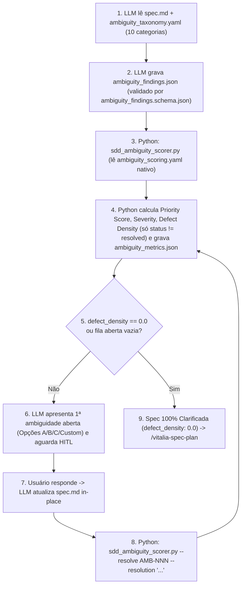

<!-- brainstorming-auditoria-kit-ativo-spec-009-010-v0.0.1.md | Vitalia Kit v0.0.1 | 26-11-2026 16:28(GMT-04:00) -->
**brainstorming-auditoria-kit-ativo-spec-009-010-v0.0.1.md | Vitalia Kit v0.0.1 | 26-11-2026 16:28(GMT-04:00)**

# Brainstorming & Auditoria Integral do Kit Ativo — Rumo às Specs 009 e 010 (Determinismo Python, Contratos Orientados a Schemas e Higiene de Camada 3)

> **Repositório de Concepção e Documentação:** `/home/andre/projetos/assistidos/vitalia-docs`  
> **Kit Ativo Auditado (Camada 2):** `/home/andre/.vitalia-kit` (sincronizado com `/home/andre/projetos/assistidos/vitalia-kit` `HEAD 8ca2398`)  
> **Data/Hora de Consolidação:** `26-11-2026 16:28(GMT-04:00)` — `America/Cuiaba`  
> **Diretriz Soberana Aprovada:** Entregar todas as partes possíveis do processo a funções determinísticas em Python, deixar ao LLM apenas o julgamento semântico indispensável, exigir que o LLM opere estritamente ancorado em **schemas** em toda manipulação de arquivos e dividir a evolução em entregas coesas para preservar a estabilidade do produto MVP.

---

## 1. Contexto Inicial: Leitura das Specs 007/008 e Paridade do Kit Ativo

### 1.1 Verificação de Paridade Camada 1 (`vitalia-kit/source/`) ↔ Camada 2 (`~/.vitalia-kit/`)
- A comparação recursiva via `diff -rq` entre `/home/andre/.vitalia-kit/{src,extensions,profiles,templates}` e `/home/andre/projetos/assistidos/vitalia-kit/source/{src,extensions,profiles,templates}` confirmou **0 diferenças** (`HEAD 8ca2398`).
- O histórico recente do repositório `vitalia-kit` compreende três marcos consecutivos:
  1. **Spec 007 (`48c9eac` — `specs/007-correcoes-rodada-3-vitalia-kit`):** Erradicação de referências legadas (`.vitalia/session/data`, `.vitalia-spec-kit`, `"Vitalia SPEC Kit"`), logs cumulativos em modo append com timestamp `GMT-04:00` e espelho em `.vitalia/memory/data_storage/telemetry/install.log`, `DashboardRenderer` unificado em `.vitalia/memory/session/README.md`, `GroundingRenderer` com projeção dual de `grounding-domains.jsonl` (`session/` e `data_storage/`) + `GROUNDING_DOMAINS.md`, migração dos `25 gp_*.yaml` para o `Schema #02` (`GuardianContextV2`), remoção de `pipeline.json`/`pipe.json` dos `34 .toml` e alinhamento normativo de documentos.
  2. **Hotfix P0 (`7b84449`):** Restauração emergencial de prompts SDD que haviam sido trocados ou comprimidos (`architect.toml`, `judge.toml`, `spec-implement.toml`, `literature-curator.toml`, `visual-creator.toml`) e introdução do Guardrail `G1` (`source/tests/test_extension_prompt_identity.py`).
  3. **Spec 008 (`8ca2398` — `specs/008-core-researcher-contrato-p03`):** Restauração do protocolo autocontido de 8 passos em `research.toml` (fim da recursão infinita de auto-delegação e restauração de `[context].writes`), unificação do contrato canônico `evidence_record.schema.json` sem retrocompatibilidade para chaves legadas (`retrieved_at`, `source_url`, `evidence_id`, `domain_id`, `domain_tags`, `valid`, `relevance_score`, `source_tier`, `status_code`), evolução do portão `vitalia_grounding_validator.py --mode evidence` (`--evidence-dir`, `--domains-yaml`, SHA-256 real em disco, janela 90d `GMT-04:00`, `literal_quote`, política D18 e escalação HITL), instalação de `source/templates/grounding_audit_template.md`, refatoração de `grounding_audit_renderer.py` com links relativos portáveis (zero `file://`) + correção de escape dos badges Shields.io, suporte a `--direction {forward,reverse}` em `vitalia_handoff.py create` e Guardrail `G2` (*Schema-First Fixtures*).
- **Sobre a Spec 009:** Confirmado que ainda não existe diretório `specs/009-*` em `/home/andre/projetos/assistidos/vitalia-kit/specs/`; o backlog inicial da Spec 009 encontrava-se registrado na fronteira explícita da Spec 008 (`spec.md` seção 1.1 item 5 e `research-brainstorming.md` seção 3).

---

## 2. Varredura Completa do Código do Kit Ativo (`/home/andre/.vitalia-kit`)

A leitura integral de todos os módulos Python em `src/` (`core/`, `hooks/`, `maintenance/`, `rendering/`, `schemas/`, `security/`, `sensors/`, `telemetry/`, `tools/` e scripts de topo), scripts Bash em `bin/` (`install-project`, `vitalia-clean`, `bin/lib/*.sh`, `kit-bootstrap.sh`), `34` extensões `.toml` e `25` perfis `gp_*.yaml` confirmou tanto o backlog mapeado para a Spec 009 quanto **novos defeitos críticos de runtime e quebras de contrato** até então ocultos.

### 2.1 Achados Já Mapeados para a Spec 009 (Confirmados no Código Ativo)

| ID | Módulo / Arquivo no Kit Ativo | Diagnóstico Confirmado Linha a Linha |
|---|---|---|
| **N2 + Ponto 5** | `src/core/grounding_domain_updater.py:125-149` `src/rendering/dashboard_renderer.py:242-254` `src/vitalia_context_engine.py:239-254, 96-237` | `GroundingDomainUpdater.list_pending_domains()` (`L142`) e `DashboardRenderer._count_pending_grounding()` (`L248`) ainda filtram `if rec.get("grounding_decision") == "pending":` e leem `domain_id`, `evidence_id`, `source_url` — campos abolidos pelo contrato canônico `evidence_record.schema.json` na Spec 008. Sobre qualquer `evidence.jsonl` real gerado pós-Spec 008 (onde o marcador é `domain_match == "general_web"` e `url`/`final_url`/`sha256`), ambos retornam sempre `0`. Adicionalmente, `vitalia_context_engine.py` (`cmd_end`) ainda não exibe a contagem informativa somente-leitura de pendências `general_web` ao encerrar a sessão (Ponto 5). |
| **N3** | `src/vitalia_context_engine.py:128` | `mname = str(payload.get("machine_name") or get_machine_identity())` converte a tupla inteira retornada por `get_machine_identity()` (`Tuple[str, str]`) em string, gravando literalmente `"('servido', '72a556ad')"` em `machine_name` do `session_ledger.json` e em `source_origin` do `learnings.jsonl` (comprovado no `session/README.md` real deste repositório). Deve usar `get_machine_identity()[0]`. |
| **N4 / N5** | `src/hooks/guardian_context.py:148, 165, 285` | 1. `L148`: mantém fallback legado `self.cwd / ".vitalia" / "data"`. 2. `L165`: ordena histórico com `entries.sort(key=lambda x: str(x.get("timestamp", "")), reverse=True)` sobre strings `DD-MM-YYYY HH:MM:SS(GMT-04:00)` (ordenação lexicográfica por **dia do mês** em vez de data cronológica via `parse_sync_time`). 3. `L285`: `export_and_publish()` usa `out_file.write_text(...)` não-atômico. |
| **Ponto 1** | `extensions/*.toml` (`34` arquivos) | Apenas `2/16` workflows alvo (`spec-plan.toml` e `spec-specify.toml`) possuem o bloco verificável de checklist pré-síntese (`- [ ]`). Faltam os outros `14` workflows de concepção, revisão e especialistas (`brainstorming`, `architect`, `science-review`, `integrative-review`, `caio-strategist`, `medical-gate`, `literature-curator`, `design-thinking`, `visual-creator`, `figma-maestro`, `django-stark`, `react-vinci`, `infra-nomad`, `cortex-analyst`). |
| **Pontos 6b / 6c** | `src/schemas/grounding_domains.schema.json` `profiles/grounding_domains.yaml` `src/core/grounding_domain_updater.py:171-183` | `grounding_domains.schema.json` ainda não declara a propriedade booleana opcional `hitl_on_use`; nenhum dos 12 domínios em `profiles/grounding_domains.yaml` possui `hitl_on_use` declarado; faltam as 10 novas fontes autoritativas tipadas (FastAPI, Vue, Terraform, AWS, Azure, Martin Fowler, Node.js, npm, Hugging Face, LangChain); e `GroundingDomainUpdater._promote_to_catalog()` precisa preservar `hitl_on_use` e `constitution_principles` ao atualizar o catálogo. |
| **Blindagem Architect** | `src/sdd_architect_mode_classifier.py:179` `src/schemas/` | O schema `src/schemas/architect_mode_diagnostics.schema.json` ainda não existe, e `sdd_architect_mode_classifier.py` grava o diagnóstico com `out_path.write_text(...)` não-atômico e sem validação `jsonschema.validate()`. |

---

### 2.2 Novos Defeitos Críticos e Lacunas Descobertos na Varredura Profunda (`A` a `E`)

#### A. `sdd_ambiguity_scorer.py` — 3 Quebras Fatais no Fluxo de `/vitalia-clarify`
1. **`json.loads()` aplicado a arquivos `.yaml` (`L198` e `L221`):**
   - Na linha `198`, o script executa `scoring_config = json.loads(scoring_path.read_text(encoding="utf-8"))`.
   - Na linha `221`, executa `schema = json.loads(taxonomy_path.read_text(encoding="utf-8"))`.
   - Contudo, os artefatos reais do kit passados pelo workflow `/vitalia-clarify` (`CONTRATOS_WORKFLOWS_SDD.md:944-945`) são arquivos **YAML**: `profiles/ambiguity_scoring.yaml` e `profiles/ambiguity_taxonomy.yaml`. Ao receber arquivos `.yaml`, o script falha com `json.JSONDecodeError` (ou, no bloco `--taxonomy`, captura a exceção em `L225` imprimindo apenas `AVISO: validação de taxonomia falhou` e retornando `exit 0`, violando a política *fail-closed* P11/P12).
2. **Chaves inexistentes e fórmula matemática divergente em `score_full()` (`L91-110` e `L129-134`):**
   - `score_full()` procura `scoring_config.get("weights", {})` e `scoring_config.get("severity_multipliers", {})`.
   - Essas chaves **não existem** em `profiles/ambiguity_scoring.yaml` nem em `src/schemas/ambiguity_scoring.schema.json` (cujas chaves canônicas são `impact_scale`, `uncertainty_scale`, `domain_multipliers` e `severity_thresholds`).
   - Se o arquivo `ambiguity_findings.json` não trouxer `"priority_score"` pré-calculado pelo LLM (o que contraria a própria existência do script!), `score_full()` ignora `impact`, `uncertainty` e `domain` e calcula `1.0 * 1.0 = 1.0` para todas as ambiguidades!
   - Além disso, `defect_density` em `L129-134` divide por `fr_count` (`len(scored) / fr_count`) em vez da fórmula formal NASA ARM `(total_ambiguities / total_lines) * 100`, e a gravação em `L261` (`out_path.write_text`) não é atômica.
3. **Confusão entre Catálogo Taxonômico (`profiles/ambiguity_taxonomy.yaml`) e Schema de Saída (`src/schemas/ambiguity_taxonomy.schema.json`):**
   - O parâmetro `--taxonomy` recebe o catálogo das 10 categorias (`profiles/ambiguity_taxonomy.yaml`), mas o código em `L222` tenta usá-lo como `schema=` do `jsonschema.validate(instance=result, schema=schema)` para validar o relatório `ambiguity_metrics.json`!

#### B. Colisão de Flags CLI entre Scripts Python e Contratos `.toml` (`CONTRATOS_WORKFLOWS_SDD.md`)
1. **`vitalia_handoff.py create` (`L282-290`) vs. `brainstorming.toml`, `route.toml` e `research.toml`:**
   - O subcomando `create` aceita apenas `--payload <file> --handoff-dir <dir> [--direction {forward,reverse}]`.
   - Já `CONTRATOS_WORKFLOWS_SDD.md` (`L355-364`, `L469-478`, `L564-573`) instrui os agentes a invocarem `vitalia_handoff.py create` com `--source`, `--target`, `--direction`, `--intent`, `--input`, `--summary`, `--domain`, `--feature`, o que resulta em falha imediata do `argparse` (`exit 2: unrecognized arguments`).
2. **`sdd_architect_mode_classifier.py` (`L155-163`) vs. `architect.toml`:**
   - O script aceita `--project-dir`, `--signals`, `--modes-file`, `--output`.
   - O contrato de `architect.toml` (`CONTRATOS_WORKFLOWS_SDD.md:679-685`) invoca `--feature`, `--workspace`, `--catalog`, `--args`, `--output`, falhando com `exit 2`.

#### C. Furo de Indexação e Limpeza na Camada 3 (`<cat>/index.jsonl` ↔ `scan_environment.py` ↔ `vitalia_tmp_cleanup.py`)
1. **Arquivos órfãos de contexto imunes ao `vitalia-clean` (comprovado no disco deste repositório `vitalia-docs`):**
   - `scan_environment.py:61-90` conta todos os arquivos `.json` físicos em `.vitalia/memory/data_storage/context/<machine_id>/` via `os.scandir`.
   - Já `vitalia_tmp_cleanup.py:161-185` coleta arquivos elegíveis de `context`, `diagnostics` e `telemetry` **lendo exclusivamente `<cat>/index.jsonl`**.
   - Neste próprio repositório `vitalia-docs`, existem **15 arquivos `.json`** em `context/72a556ad/`, mas apenas **12 entradas** em `context/index.jsonl` (`brainstorming_319d635974d3.json`, `session-start_52f7e167c07e.json` e `session-start_d04456e199ab.json` estão fora do índice). Esses arquivos órfãos (assim como logs `vrss_exec_*.log` gerados por `vrss_exec.py:126` em `context/<machine_id>/` e `guardian_*.json` de `guardian_context.py:284`) jamais são removidos pelo `vitalia-clean`, travando `needs_cleanup: true` perpetuamente quando acumulam $\ge 10$ arquivos.
2. **`handoffs`, `diagnostics`, `research` e `telemetry` nunca atualizam `<cat>/index.jsonl`:**
   - Apenas `vitalia_hook_runner.py:357` chama `register_data_storage_item(context_root, ...)`.
   - `vitalia_handoff.py`, `sdd_architect_mode_classifier.py`, `stuck_detector.py`, `grounding_audit_renderer.py` e `otel_genai.py` nunca registram itens em `index.jsonl`, fazendo com que `session/README.md` e `data_storage/README.md` mostrem sempre `0` itens para essas categorias.
3. **Limpeza incompleta de `research/<tema>/` expirado (`vitalia_tmp_cleanup.py:134-140, 188-200`):**
   - Ao limpar pesquisas com mais de 90 dias, remove apenas `evidence.jsonl` (e tenta remover um inexistente `evidence.md`), deixando `GROUNDING_AUDIT.md`, `urls.txt` e toda a subpasta `snapshots/*.txt` órfãos em disco.

#### D. Prompts "Stub" de 8 Linhas, `yaml_sources` Omitidos e `reads`/`writes` Vazios nos `.toml` Ativos
- **7 workflows centrais do ciclo SDD** no kit ativo permanecem com prompts genéricos de ~8 linhas (~770–820 caracteres) e sem seus catálogos `yaml_sources` obrigatórios:
  1. `brainstorming.toml` (`798` chars): sem o ciclo `FOCUS ➔ EXAMINE ➔ FORMULATE ➔ HARVEST`, sem template socrático, sem instruções de `research-brainstorming.md`/handoff e com `yaml_sources = ["constitution"]` (faltam `dynamic_questioning`, `brainstorming_intents`, `agents_catalog`, `grounding_domains` — **nenhum** workflow ativo carrega `brainstorming_intents` ou `dynamic_questioning` hoje!).
  2. `clarify.toml` (`827` chars): sem os 6 passos operacionais, sem comando do `sdd_ambiguity_scorer.py`, sem template `A/B/C/Custom` e sem `ambiguity_taxonomy` em `yaml_sources`.
  3. `route.toml` (`797` chars): sem as 3 etapas de despacho, sem template HITL e sem `brainstorming_intents` e `agents_catalog` em `yaml_sources`.
  4. `session-end.toml` (`790` chars): sem as 4 fases, estrutura de `.vitalia/end_payload.json` e comando `vitalia_context_engine.py --action end --payload-file .vitalia/end_payload.json`.
  5. `session-consolidate.toml` (`822` chars): sem os 5 passos Git push/pull, `list-pending-domains`, estrutura de `.vitalia/grounding_decisions_payload.json`, comando `--update-grounding-domains` e sem `ask_question` em `tools`.
  6. `session-start.toml` (`1157` chars): usa placeholder `{{PROJECT_ROOT}}` (inexistente em `vitalia_hook_runner.py:132`), omite Passo 1 (`git pull --rebase`) e o template de apresentação do Passo 4.
  7. `converge.toml` (`774` chars): sem os 5 passos de reconciliação e sem `grounding_domains`, `routing_table`, `agents_catalog` em `yaml_sources`.
- **13 workflows** (`spec-specify`, `spec-plan`, `spec-tasks` e os 10 especialistas) estão com `[context] reads = []` e `writes = []` nos `.toml` compilados.
- **25 `gp_*.yaml` compilados:** possuem apenas 3 `mandatory_checks` curtos e `source_weights` fixos em `['constitution', 'phase_guardrails', 'grounding_domains']`.

#### E. Achados Extras em `guardian_context.py`, `vrss_exec.py`, `bin/lib/` e Escritas Não-Atômicas
1. `src/hooks/guardian_context.py:172-212`: `_load_session_context(self, profile)` ignora o argumento `profile` (nunca carrega o `p0` / `next_step` do shard ativo em `session_ledger.json` mesmo quando `include_p0: true`), e `latest_handoff()` injeta handoffs `"pending"` sem verificar se já expiraram pelo `ttl_seconds`.
2. `src/vrss_exec.py:45`: redefine `get_machine_id()` usando `socket.gethostname()` sem `.lower()` (divergindo de `core.utils.get_machine_id()` em máquinas cujo hostname contenha letras maiúsculas).
3. `bin/lib/env_manager.sh:54`: `storage_mode = "dual-repo" if (session_repo or data_repo) else "local-only"` grava `"dual-repo"` mesmo quando apenas 1 repositório é informado (deveria gravar `"partial-repo"` quando apenas um estiver preenchido, alinhado a `dashboard_renderer.py:191`).
4. `bin/lib/agent_preserver.sh:58-74`: ao atualizar o bloco `VITALIA:KIT` em um `AGENTS.md` existente, não atualiza o timestamp P04 das linhas 1–2 e hardcoda `v0.0.1` em vez de ler `VERSION`.
5. **7 escritas não-atômicas (`write_text` direto em vez de `mkstemp` + `os.replace`):**
   - `src/hooks/guardian_context.py:285`
   - `src/sdd_architect_mode_classifier.py:179`
   - `src/sdd_ambiguity_scorer.py:261`
   - `src/rendering/data_storage_dashboard_renderer.py:148, 152` (além de badges Shields.io sem escape em `L63, L103`)
   - `src/vitalia_hook_runner.py:379`
   - `src/tools/context_saturation_monitor.py:143`

---

## 3. Elucidação Profunda #1: O "Espírito" de `/vitalia-clarify` e `sdd_ambiguity_scorer.py`

### 3.1 Princípio Diretor: Máximo Determinismo no Python, Mínimo Esforço Aritmético/Estrutural no LLM
O objetivo do par `/vitalia-clarify` + `sdd_ambiguity_scorer.py` é impedir que o LLM invente fórmulas, ordene filas de cabeça ou edite contadores de densidade manualmente.

### 3.2 Divisão Exata de Responsabilidades
1. **O que fica exclusivamente com o LLM (Capacidade Semântica):**
   - Ler o `spec.md` à luz das 10 categorias de `ambiguity_taxonomy.yaml` (`Lexical`, `Syntactic`, `Semantic`, `Incompleteness`, `Vagueness`, `Inconsistency`, `NonVerifiable`, `Redundancy`, `Consumer`, `Boundary`).
   - Gravar `specs/<feature>/ambiguity_findings.json` (seguindo `ambiguity_findings.schema.json`) contendo apenas os fatos semânticos de cada achado: `id` (`AMB-001`), `category`, `topic`, `spec_lines`, `domain` (`general`, `architecture`, `security`, `clinical_safety`, etc.), `impact` (número `1.0`–`5.0` ou rótulo `low|medium|high|critical`), `uncertainty` (número `1.0`–`3.0` ou rótulo `low|medium|high`), `status` (`"open"` por padrão) e `summary`.
   - Apresentar **uma pergunta por turno** ao usuário (com recomendação e tabela `A / B / C / Custom`), integrar a resposta escolhida diretamente no texto do `spec.md` e acionar a resolução determinística no script Python.
2. **O que passa a ser 100% determinístico no Python (`sdd_ambiguity_scorer.py`):**
   - **Passo 1 — Leitura Universal YAML/JSON e Defaults Automáticos do Kit:**
     - Substituir `json.loads()` em `--scoring` e `--taxonomy` por `_load_yaml_or_json()`, que aceita tanto `.yaml` (`yaml.safe_load`) quanto `.json`.
     - Quando `--scoring` ou `--taxonomy` forem omitidos na CLI, resolver automaticamente `<kit_dir>/profiles/ambiguity_scoring.yaml` e `<kit_dir>/profiles/ambiguity_taxonomy.yaml` via `kit_env_bootstrap.resolve_kit_dir()`.
   - **Passo 2 — Resolução de Escalas, Multiplicadores e Severidade sobre `ambiguity_scoring.yaml`:**
     - Converter rótulos textuais (`"high"` $\rightarrow 3.5$ em `impact_scale`; `"medium"` $\rightarrow 2.0$ em `uncertainty_scale`) ou valores numéricos diretos.
     - Resolver `domain_multiplier` em `domain_multipliers` a partir de `domain` / `domain_id` / `domain_weight` (com fallback seguro para `general: 1.0`).
     - Calcular deterministicamente:
       $$\text{priority\_score} = \text{round}(\text{impact} \times \text{uncertainty} \times \text{domain\_multiplier},\ 4)$$
       *(preservando fallback para `weights * severity_multipliers` apenas se um teste legado passar JSON com a chave `"weights"`)*.
     - Determinar `severity` (`critical`, `high`, `medium`, `low`) comparando `priority_score` contra `severity_thresholds` do `ambiguity_scoring.yaml`.
   - **Passo 3 — Ciclo de Vida `open` $\rightarrow$ `resolved` e Flag `--resolve`:**
     - Aceitar a lista de entrada em `ambiguity_findings.json` tanto na chave `ambiguities` quanto em `detected_ambiguities` (validada contra `ambiguity_findings.schema.json`).
     - Se invocado com `--resolve <AMB-ID> --resolution "<texto>"`, atualizar atomicamente o item correspondente em `ambiguity_findings.json` para `"status": "resolved"` e `"resolution": "<texto>"` antes de recalcular as métricas.
     - Separar itens **abertos** (`status != "resolved"`) dos **resolvidos** (`status == "resolved"`):
       - `total_ambiguities`: `len(open_items)` (fila pendente real).
       - `resolved_ambiguities`: `len(resolved_items)`.
       - `total_lines`: total de linhas de `spec.md`.
       - `defect_density`: `round((len(open_items) / max(total_lines, 1)) * 100, 4)`.
       - `detected_ambiguities`: fila de `open_items` ordenada por `(-priority_score, id)`.
   - **Passo 4 — Validação Estrita Fail-Closed e Escrita Atômica:**
     - Validar `result` sempre contra `src/schemas/ambiguity_taxonomy.schema.json` via `jsonschema.validate()`, abortando com `exit 1` em caso de violação, e gravar `ambiguity_metrics.json` via escrita atômica (`mkstemp` + `os.replace`).

---

## 4. Elucidação Profunda #2: Refatoração de `vitalia_handoff.py` e Matriz de Handoffs em `CONTRATOS_WORKFLOWS_SDD.md` (Visão de MVP)

### 4.1 Lista Ampliada de Handoffs Mapeados em `CONTRATOS_WORKFLOWS_SDD.md` vs. Necessidade Real no MVP

| # | Origem $\rightarrow$ Destino | `direction` | `intent_type` (`vitalia-handoff-v1.0.0.json`) | Avaliação Crítica para o Produto **MVP** |
|---|---|---|---|---|
| **H1** | **`research.toml` (`vitalia-researcher`) $\rightarrow$ Workflow Invocador** (`CONTRATOS` L55, L469, L763) | `reverse` | `subagent_response` | **ESSENCIAL (MVP P0):** Comprova deterministicamente que o subagente concluiu o protocolo P03 e entregou `GROUNDING_AUDIT.md`. |
| **H2** | **`brainstorming.toml` $\rightarrow$ `route.toml`** (`CONTRATOS` L355) | `forward` | `brainstorming_to_route` | **ESSENCIAL (MVP P0):** Transfere a intenção concebida e o caminho de `research-brainstorming.md` para o despachante `/vitalia-route`. |
| **H3** | **`route.toml` $\rightarrow$ Especialista / `architect.toml`** (`CONTRATOS` L564) | `forward` | `route_dispatch` ou `route_to_brainstorming` | **ESSENCIAL (MVP P0):** Materializa o roteamento confirmado pelo usuário (HITL) para que o especialista receba o contexto em `guardian_json.session_context.handoff`. |
| **H4** | **`architect.toml` $\leftrightarrow$ Especialistas de Domínio (Bounded Spikes)** (`CONTRATOS` L759-763) | `forward` / `reverse` | `brainstorming_delegate` / `subagent_response` | **SUPORTADO PELA MESMA CLI:** Opera com os mesmos parâmetros de `H1`–`H3` quando o Architect delega um spike a um especialista. |
| **H5** | **Transições Lineares Internas do Ciclo SDD (`specify` $\rightarrow$ `clarify` $\rightarrow$ `plan` $\rightarrow$ `tasks` $\rightarrow$ `task-verifier` $\rightarrow$ `analyze` $\rightarrow$ `implement` $\rightarrow$ `converge`)** | `forward` | `sdd_pipeline_advance` | **DESNECESSÁRIO EXIGIR NO MVP:** Dentro de uma mesma feature, o estado já está 100% persistido em `.vitalia/feature.json` + `specs/<feature>/{spec,plan,tasks}.md`. Tornar handoff obrigatório entre etapas lineares só gera atrito. |
| **H6** | **Ações de Sessão / Fallback (`session_action`)** | `fallback` | `session_action` | **ADIAR (Pós-MVP):** Sem consumidor ativo nos workflows de sessão atuais. |

### 4.2 Especificação da Refatoração Determinística de `vitalia_handoff.py create`
Para eliminar a necessidade de o LLM redigir manualmente um JSON de 35 linhas com 4 blocos aninhados (`envelope`, `intent`, `session_snapshot`, `routing`), o subcomando `vitalia_handoff.py create` passa a operar em **Modo Híbrido Determinístico**:
1. **Flags CLI de 1ª Classe (compatíveis com `brainstorming.toml`, `route.toml`, `research.toml` e `architect.toml`):**
   - `--source <workflow>` (mapeado para `envelope.source_workflow`)
   - `--target <workflow>` (mapeado para `envelope.target_workflow`)
   - `--direction {forward,reverse,fallback}` (default: `"forward"`)
   - `--intent <intent_type>` (default inteligente: `"subagent_response"` se `direction == "reverse"`, `"brainstorming_to_route"` se `source == "brainstorming"`, `"route_dispatch"` se `source == "route"`, senão `"sdd_pipeline_advance"`)
   - `--input <texto>` (mapeado para `intent.source_input`)
   - `--summary <texto_ou_path>` (mapeado para `intent.normalized_summary`)
   - `--domain <dominio>` (mapeado para `intent.detected_domain`)
   - `--feature <feature_dir>` (mapeado para `intent.feature_context` e `session_snapshot.active_feature`; se omitido, lido automaticamente de `.vitalia/feature.json`)
   - `--command <slash_cmd>` (mapeado para `routing.suggested_command`; default: `f"/vitalia-{target}"`)
   - `--confidence <float>` (default: `1.0`)
   - `--handoff-dir <dir>` (default automático: `.vitalia/memory/data_storage/handoffs`)
   - `--payload <json_file>` (**opcional**: quando informado, carrega a base do arquivo JSON e aplica qualquer flag CLI passada como override, garantindo **100% de retrocompatibilidade** com todos os testes das Specs 005–008).
2. **Síntese e Validação Determinística no Python:**
   - Preenche automaticamente `schema_type: "workflow_handoff"`, `schema_version: "1.0.0"`, `handoff_id` (`uuid4()`), `created_at` (`GMT-04:00`), `ttl_seconds: 86400`, `machine_id` (`get_machine_id()`) e `status: "pending"`.
   - Valida *fail-closed* contra `src/schemas/vitalia-handoff-v1.0.0.json` (rejeitando `"$schema"` com `exit 1`).
   - Registra automaticamente o item em `handoffs/index.jsonl` + gera view `.md` Nível 2 via `register_data_storage_item()` / `render_item_view_md()`.
3. **Filtro de TTL no Consumidor (`guardian_context.py:latest_handoff()`):**
   - Antes de injetar `session_ctx["handoff"]`, verificar `_is_expired(data)` para nunca injetar handoffs `"pending"` vencidos.

---

## 5. Elucidação Profunda #3: Finalidade de `index.jsonl`, Quem Insere Nele e Arquitetura de `register_data_storage_item()`

### 5.1 Finalidade Real de `.vitalia/memory/data_storage/<categoria>/index.jsonl`
O arquivo `index.jsonl` em cada subpasta da Camada 3 existe para alimentar três consumidores determinísticos sem leitura profunda de todos os arquivos JSON do repositório:
1. **`DataStorageDashboardRenderer` (`src/rendering/data_storage_dashboard_renderer.py:27-40`):** Lê exclusivamente `<cat>/index.jsonl` para montar `data_storage/README.md` (Nível 0) e `<cat>/README.md` (Nível 1).
2. **`DashboardRenderer` (`src/rendering/dashboard_renderer.py:375-381`):** Conta as linhas de `<cat>/index.jsonl` para renderizar a tabela *"Resumo Numérico da Camada 3 (`data_storage`)"* no `session/README.md`.
3. **`VitaliaTmpCleanup` (`src/vitalia_tmp_cleanup.py:160-185`):** Consulta `index.jsonl` para listar itens de `context`, `diagnostics` e `telemetry` e chama `resync_category_index(cat_dir)` após remoções.

### 5.2 Quem Insere Dados em `index.jsonl` Hoje?
- **Apenas `vitalia_hook_runner.py:357`** (na categoria `context/`).
- Nenhum outro módulo do kit chama `register_data_storage_item()` hoje.

### 5.3 Arquitetura Correta: Onde Acionar `register_data_storage_item()` vs. Varredura em Disco
As 6 categorias de `data_storage/` dividem-se em duas naturezas distintas:

| Categoria em `data_storage/` | Natureza Física dos Arquivos | Deve Acionar `register_data_storage_item()`? | Como Indexar e Limpar Corretamente |
|---|---|---|---|
| **`context/`** | Envelopes discretos `<machine_id>/<workflow>_<hash>.json` + `.md` | **SIM** (já acionado em `vitalia_hook_runner.py:357`) | `vitalia_hook_runner.py` registra na criação; `vitalia_tmp_cleanup.py` varre todos os `.json`/`.log` físicos em `context/` (incluindo órfãos fora do índice) e executa `resync_category_index()` ao final. |
| **`handoffs/`** | Envelopes discretos `<handoff_id>.json` + `.md` | **SIM** (acionar em `vitalia_handoff.py:cmd_create`) | `vitalia_handoff.py create` grava `<id>.json`, gera `<id>.md` via `render_item_view_md()` e chama `register_data_storage_item(handoff_dir, ...)`. |
| **`research/`** | Pastas por tema `<tema>/evidence.jsonl` + `<tema>/GROUNDING_AUDIT.md` + `snapshots/` | **SIM** (acionar em `grounding_audit_renderer.py:main`) | Ao gravar `<tema>/GROUNDING_AUDIT.md` dentro de `data_storage/research/<tema>/`, registrar `{"id": topic, "title": f"Auditoria P03: {topic}", "json_path": f"{topic}/evidence.jsonl", "md_path": f"{topic}/GROUNDING_AUDIT.md"}` em `research/index.jsonl`. Na limpeza $> 90$d, remover o diretório `<tema>/` completo (`shutil.rmtree`) e ressincronizar o índice. |
| **`diagnostics/`** | Relatórios discretos (`architect_mode_diagnostics.json`, `stuck_state.json`) | **SIM** (acionar em `sdd_architect_mode_classifier.py`) | Ao gravar o diagnóstico em `data_storage/diagnostics/`, registrar no `diagnostics/index.jsonl`; `vitalia_tmp_cleanup.py` varre `.json` físicos não-hoje e ressincroniza o índice. |
| **`backups/`** | Cópias brutas (`AGENTS.md.bak.*`, `legacy-gemini-*`) criadas via Bash (`agent_preserver.sh`) | **NÃO** (descoberta direta em disco) | Mantido por contagem de arquivos físicos em disco (`--keep-backups 5`). |
| **`telemetry/`** | Streams contínuos (`install.log`, `genai_events.jsonl`) | **NÃO** (streams append-only) | `install.log` permanece protegido como trilha histórica; `DashboardRenderer` pode contabilizar entradas reais ou arquivos presentes sem depender de `register_data_storage_item`. |

---

## 6. Elucidação Profunda #4 (Nova Diretriz Arquitetural): Manipulação de Arquivos pelo LLM 100% Orientada a Schemas

### 6.1 Diagnóstico Factual: Os Workflows Atuais se Organizam Orientados a Schemas?
**Não.** A auditoria automatizada sobre os 34 workflows compilados em `/home/andre/.vitalia-kit/extensions/` comprovou que:
1. **33 dos 34 workflows ativos têm `schemas_mentioned = []`** (zero referências a arquivos `*.schema.json` tanto em `[context].reads` quanto em `guardian.prompt`).
2. **Apenas 1 workflow (`research.toml`, atualizado na Spec 008)** referencia explicitamente seu schema (`evidence_record.schema.json`).
3. Em `CONTRATOS_WORKFLOWS_SDD.md`, apenas 3 workflows mencionavam schemas em `[context].reads` (`session-end.toml`, `session-consolidate.toml` e `skill-evaluation.toml`), e essas referências **foram perdidas** quando os `.toml` de `source/layers/extensions/` foram comprimidos em stubs de 8 linhas.
4. O compilador de contexto `GuardianContextV2` (`src/hooks/guardian_context.py`) carrega apenas `yaml_sources` (`profiles/*.yaml`) para dentro de `guardian_json.sources`, **não injetando nenhum schema JSON de `src/schemas/`** no envelope §11 lido pelo LLM no Passo 1.
5. Vários arquivos JSON/YAML críticos manipulados pelo LLM ou pelos scripts dos workflows **não possuem schema correspondente em `src/schemas/`**.

### 6.2 Mapa dos 24 Schemas Existentes em `src/schemas/` vs. Uso Real nos Workflows

| # | Schema Existente (`src/schemas/`) | Artefato Alvo | Status Atual no Código / Workflows |
|---|---|---|---|
| 01 | `context-lifting-envelope.schema.json` | Envelope §11 (`context/<mid>/<wf>_<hash>.json`) | Validado em testes; produzido por `vitalia_hook_runner.py`. |
| 02 | `guardian_profile.schema.json` | `profiles/gp_*.yaml` (`25` perfis) | Validado em testes; consumido por `GuardianContextV2`. |
| 03 | `constitution.schema.json` | `profiles/constitution.yaml` | Validado em testes; compilado por `vitalia_layer_compiler.py`. |
| 04 | `vitalia-handoff-v1.0.0.json` | `data_storage/handoffs/<id>.json` | Validado por `vitalia_handoff.py`; **ausente** dos prompts/contexto de `brainstorming.toml` e `route.toml`. |
| 05 | `feature_metadata.schema.json` | `.vitalia/feature.json` | Gravado pelo LLM em `spec-specify.toml`, mas **não referenciado nem validado** no workflow! |
| 06 | `context_cleanup.schema.json` | `env_summary.context_cleanup` | Produzido por `scan_environment.py`. |
| 07 | `grounding_domains.schema.json` | `profiles/grounding_domains.yaml` | Validado por `GroundingDomainUpdater`; falta propriedade `hitl_on_use` (Ponto 6c). |
| 08 | `grounding_domains_lock.schema.json` | `profiles/grounding_domains.lock.json` | Lido por `vitalia_grounding_validator.py --mode artifact`. |
| 09 | `evidence_record.schema.json` | `data_storage/research/<tema>/evidence.jsonl` | **Alinhado na Spec 008:** referenciado em `research.toml` e validado em `vitalia_grounding_validator.py --mode evidence`. |
| 10 | `grounding_decision.schema.json` | `data_storage/grounding_decisions.jsonl` & `grounding-domains.jsonl` | Validado em `GroundingDomainUpdater` e `GroundingRenderer`; **ausente** do prompt ativo de `session-consolidate.toml`. |
| 11 | `agents_catalog.schema.json` | `profiles/agents_catalog.yaml` | Catálogo lido por `architect`, `route`, `spec-implement`, `judge`. |
| 12 | `routing_table.schema.json` | `profiles/routing_table.yaml` | Catálogo lido por `route`, `architect`, `converge`. |
| 13 | `brainstorming_intents.schema.json` | `profiles/brainstorming_intents.yaml` | Catálogo **ausente** de `yaml_sources` em `brainstorming.toml` e `route.toml` no kit ativo! |
| 14 | `dynamic_questioning.schema.json` | `profiles/dynamic_questioning.yaml` | Catálogo **ausente** de `yaml_sources` em `brainstorming.toml` e `design-thinking.toml` no kit ativo! |
| 15 | `ambiguity_scoring.schema.json` | `profiles/ambiguity_scoring.yaml` | Existe, mas `sdd_ambiguity_scorer.py` **ignora suas chaves** e tenta ler `"weights"`/`"severity_multipliers"`! |
| 16 | `ambiguity_taxonomy.schema.json` | `specs/<feature>/ambiguity_metrics.json` | Valida a **saída** `ambiguity_metrics.json`, mas o nome confunde com o catálogo `profiles/ambiguity_taxonomy.yaml` e falta o schema da **entrada** `ambiguity_findings.json`! |
| 17 | `learning.schema.json` | Linha de `session/learnings.jsonl` | Validado em `vitalia_context_engine.py --action end`, mas **ausente** de `session-end.toml` e `skill-evaluation.toml` ativos. |
| 18 | `decision.schema.json` | Linha de `session/decisions.jsonl` | Validado em `vitalia_context_engine.py --action end`, mas **ausente** de `session-end.toml` ativo. |
| 19 | `session_history.schema.json` | Item de `shards[]` em `session/session_ledger.json` | Validado em `vitalia_context_engine.py --action end`. |
| 20 | `finding.schema.json` | Envelope VRSS de sensores (`sensors/*.py`, `header_stamp.py`) | Produzido por `sensors/registry.py`. |
| 21 | `vrss_exec_envelope.schema.json` | Saída de `vrss_exec.py` | Produzido por `vrss_exec.py`. |
| 22 | `context_saturation_report.schema.json` | Saída de `context_saturation_monitor.py` | Produzido por `tools/context_saturation_monitor.py`. |
| 23 | `mutation_delta_report.schema.json` | Saída de `mutmut_delta_runner.py` | Produzido por `tools/mutmut_delta_runner.py`. |
| 24 | `otel_genai_event.schema.json` | Linha de `telemetry/genai_events.jsonl` | Produzido por `telemetry/otel_genai.py`. |

---

### 6.3 Schemas Faltantes a Serem Criados (Abstraídos das Intenções Reais dos Workflows)

Para que **nenhum arquivo JSON/JSONL/YAML manipulado pelo LLM ou pelos scripts de workflow opere sem schema**, precisamos abstrair e criar os seguintes schemas em OpenAPI 3.0.3 limpo (`P11` — sem `$schema`, sem `title` raiz, sem `additionalProperties: false`, sem arrays em `type`):

| Novo Schema (`src/schemas/`) | Arquivo Físico Regido | Workflow / Script Envolvido | Intenção Abstraída & Campos Essenciais (`required` / `properties`) |
|---|---|---|---|
| **1. `ambiguity_findings.schema.json`** | `specs/<feature>/ambiguity_findings.json` | **Escrito pelo LLM** no Passo 2 de `/vitalia-clarify` e atualizado via `sdd_ambiguity_scorer.py --resolve` | Contrato único do que o LLM extrai do `spec.md`: - Raiz: `schema_version` (`"1.0.0"`), `spec_file` (`string`), `ambiguities` (`array` de objetos; aceita alias `detected_ambiguities`). - Item (`required: ["id", "category", "topic", "impact", "uncertainty"]`): `id` (`AMB-001`), `category` (`enum` das 10 categorias de `ambiguity_taxonomy.yaml`), `topic` (`string`), `spec_lines` (`array` de `integer`), `domain` (`string`, default `"general"`), `impact` (`number` `1.0`–`5.0`), `uncertainty` (`number` `1.0`–`3.0`), `status` (`enum: ["open", "resolved"]`), `resolution` (`string`), `summary` (`string`), `options` (`array` opcional de `{id, answer, technical_implications}`). |
| **2. `end_payload.schema.json`** | `.vitalia/end_payload.json` | **Escrito pelo LLM** na Fase 2 de `/vitalia-session-end` e no Passo 3 de `/vitalia-skill-evaluation`; **consumido** por `vitalia_context_engine.py --action end` | Contrato exato do payload transitório de encerramento antes de o Python sintetizar `id`, `timestamp` e `machine_id`: - `required: ["task", "p0"]` - `properties`: `task` (`string`, `minLength: 1`), `p0` (`string`, `minLength: 1`), `summary` (`string`), `status` (`enum: ["completed", "in_progress", "blocked"]`), `mode` (`string`), `steps` (`array` de `string`), `learnings` (`array` de `{category: "KIT"\|"PROJETO", learning: string, rationale: string}`), `decisions` (`array` de `{category: "ARQUITETURA"\|"PROJETO", decision: string, rationale: string, alternatives: array[string]}`). |
| **3. `grounding_decisions_payload.schema.json`** | `.vitalia/grounding_decisions_payload.json` | **Escrito pelo LLM** no Passo 3 de `/vitalia-session-consolidate`; **consumido** por `vitalia_context_engine.py --action consolidate --update-grounding-domains` | Contrato do envelope transitório de decisões HITL coletadas via `ask_question`: - `required: ["decisions"]` - `properties.decisions`: `array` de objetos com `required: ["domain", "scope"]` (`target_id`, `domain`, `name`, `scope: "global"\|"local"\|"rejected"`, `trigger: "blocking"\|"warning"\|"info"`, `description`, `project`, `gate`, `hitl_on_use`, `authoritative_sources`, `reason`, `decided_by`). |
| **4. `architect_mode_diagnostics.schema.json`** | `.vitalia/memory/data_storage/diagnostics/architect_mode_diagnostics.json` | **Gerado** por `sdd_architect_mode_classifier.py` e **lido pelo LLM** no Passo 1 de `/vitalia-architect` | Contrato formal do Triage Gate RRF: - `required: ["generated_at", "project_dir", "recommended_mode", "recommended_concern", "low_confidence", "margin", "ranked_modes"]` - `ranked_modes`: `array` de `{mode: string, concern: string, rrf_score: number, matched_signals: array[string]}`. |
| **5. `architect_modes.schema.json`** | `profiles/architect_modes.yaml` | Compilado por `vitalia_layer_compiler.py` e lido por `sdd_architect_mode_classifier.py` / `GuardianContextV2` | Contrato do catálogo de modos do Architect: - `required: ["schema_type", "schema_version", "modes"]` - `modes`: `array` de `{id, name, concern, layer, file_triggers: array[string], keywords: array[string], description}`. |
| **6. `ambiguity_taxonomy_catalog.schema.json`** | `profiles/ambiguity_taxonomy.yaml` | Injetado em `clarify.toml` e lido por `sdd_ambiguity_scorer.py` | Contrato do catálogo YAML das 10 categorias (separado de `ambiguity_taxonomy.schema.json` que valida o relatório `ambiguity_metrics.json`): - `required: ["schema_type", "schema_version", "categories"]` - `categories`: `array` de `{id, name, description, severity_default: "low"\|"medium"\|"high"\|"critical"}`. |
| **7. `data_storage_index_entry.schema.json`** | `.vitalia/memory/data_storage/<cat>/index.jsonl` | Gravado por `register_data_storage_item()` (`core/data_storage_io.py`) e lido pelos renderizadores e faxineiro | Contrato de cada linha do `index.jsonl`: - `required: ["id", "title", "json_path"]` - `properties`: `id`, `title`, `json_path`, `md_path`, `workflow`, `machine_id`, `created_at`, `category`. |
| **8. `session_ledger.schema.json`** | `.vitalia/memory/session/session_ledger.json` | Gravado por `install-project` e `vitalia_context_engine.py --action end`; auditado por `sensor_memory_ledger.py` | Contrato do documento raiz `session_ledger.json`: - `required: ["schema_version", "updated_at", "shards"]` - `shards`: `array` de objetos conformes a `session_history.schema.json`. |
| **9. `project_config.schema.json`** | `.vitalia/config.yml` | Gravado por `install-project` (`env_manager.sh`) e lido por `kit_env_bootstrap.py`, `vitalia_hook_runner.py`, `dashboard_renderer.py`, `grounding_renderer.py` | Contrato soberano da configuração do projeto: - `required: ["kit_version", "kit_dir", "project", "storage"]` - `properties`: `kit_version`, `kit_dir`, `project` (`{name, root}`), `storage` (`{mode: "local-only"\|"partial-repo"\|"dual-repo", session_repo, data_repo}`), `memory` (`{session_repo, data_repo}`), `domain_gates` (`array` de `string`), `installed_at`. |

---

### 6.4 Como Garantir que o LLM Sempre Use os Schemas (Injeção Automática via §11 Context Lifting + Validação CLI)

Para que o LLM **nunca mais manipule arquivos às cegas**, a arquitetura deve combinar **3 barreiras determinísticas**:

1. **Injeção Direta de `schemas` no Envelope §11 (`GuardianContextV2`):**
   - Adicionar suporte ao campo `schemas = [...]` na seção `[guardian]` dos arquivos `.toml` (em `source/layers/extensions/`).
   - Quando `vitalia_hook_runner.py --phase before` executa o `GuardianContextV2.build_context()`, ele carrega cada arquivo listado em `guardian.schemas` a partir de `<kit_dir>/src/schemas/<name>` e o injeta diretamente em `guardian_json["schemas"][<name>]` dentro do envelope de contexto!
   - **Efeito imediato:** Ao ler o `workflow_context_file` no Passo 1, o LLM já recebe o schema JSON exato dentro da sua janela de contexto (sem precisar fazer chamadas extras de `read_file` fora do workspace e sem adivinhar nomes de chaves):
     - `clarify.toml` $\rightarrow$ recebe `ambiguity_findings.schema.json` e `ambiguity_taxonomy.schema.json`.
     - `session-end.toml` & `skill-evaluation.toml` $\rightarrow$ recebem `end_payload.schema.json`, `learning.schema.json` e `decision.schema.json`.
     - `session-consolidate.toml` $\rightarrow$ recebe `grounding_decisions_payload.schema.json` e `grounding_decision.schema.json`.
     - `spec-specify.toml` $\rightarrow$ recebe `feature_metadata.schema.json`.
     - `research.toml` $\rightarrow$ recebe `evidence_record.schema.json` e `vitalia-handoff-v1.0.0.json`.
     - `brainstorming.toml` & `route.toml` $\rightarrow$ recebem `vitalia-handoff-v1.0.0.json`.
     - `architect.toml` $\rightarrow$ recebe `architect_mode_diagnostics.schema.json` e `vitalia-handoff-v1.0.0.json`.
2. **Substituição de Edição Manual de JSON por Flags CLI Determinísticas sempre que possível:**
   - Em `vitalia_handoff.py create`: o LLM passa `--source`, `--target`, `--direction`, `--intent`, `--input`, `--summary`, `--domain`, `--feature` e o Python monta e valida o JSON contra `vitalia-handoff-v1.0.0.json`.
   - Em `sdd_ambiguity_scorer.py --resolve <ID> --resolution "<texto>"`: o Python atualiza o status em `ambiguity_findings.json` e recalcula `ambiguity_metrics.json` validando ambos contra seus schemas.
3. **Contratos Estruturais Explícitos para Artefatos Markdown SDD (`spec.md`, `plan.md`, `tasks.md`, `research-brainstorming.md`, `Relatório de Inspeção - *.md`):**
   - Nos workflows que geram Markdown (`spec-specify`, `spec-plan`, `spec-tasks`, `brainstorming`, `judge`, `analyze`, `task-verifier`, `adr`), o prompt em `source/layers/extensions/*.toml` explicita o **Esqueleto Estrutural Obrigatório (Schema Markdown)** com cabeçalho P04 de 2 linhas, seções numeradas e identificadores regex auditáveispelos `extraction_pattern` do `gp_sdd-judge.yaml` (`FR-\d+`, `SC-\d+`, `T\d+`, `[TEST:NEW|BUGFIX|REFACTOR|MIGRATION]`).

---

## 7. Divisão Estratégica de Escopo: O que Fazer Agora (Spec 009) vs. Spec 010 vs. Backlog Pós-MVP

Para evitar degradação por excesso de escopo em uma única spec, a evolução divide-se em duas etapas cirúrgicas:

### 7.1 Etapa 1 — **Spec 009: Schemas Faltantes + Módulos Python Determinísticos & Fechamento P03/Camada 3**
Foco 100% em **contratos JSON (`src/schemas/`) e código Python determinístico (`src/`)**, com testes comportamentais P05 (`[TEST:BUGFIX]`, `[TEST:NEW]`, `[TEST:MIGRATION]`):

1. **Criação e Atualização dos Schemas em `source/src/schemas/` (OpenAPI 3.0.3 Limpo — P11):**
   - Novos schemas: `ambiguity_findings.schema.json`, `end_payload.schema.json`, `grounding_decisions_payload.schema.json`, `architect_mode_diagnostics.schema.json`, `architect_modes.schema.json`, `ambiguity_taxonomy_catalog.schema.json`, `data_storage_index_entry.schema.json`, `session_ledger.schema.json`, `project_config.schema.json`.
   - Atualização de `grounding_domains.schema.json`: adicionar propriedade booleana opcional `hitl_on_use` (Ponto 6c).
2. **Refatoração Determinística de `sdd_ambiguity_scorer.py` (`/vitalia-clarify`):**
   - Leitura nativa de YAML e JSON em `--scoring` e `--taxonomy` com fallback default para `<kit_dir>/profiles/ambiguity_scoring.yaml` e `<kit_dir>/profiles/ambiguity_taxonomy.yaml`.
   - Validação de `ambiguity_findings.json` contra `ambiguity_findings.schema.json` (aceitando `ambiguities` ou `detected_ambiguities` e convertendo rótulos `low|medium|high|critical` ou números).
   - Cálculo real via `impact_scale`, `uncertainty_scale`, `domain_multipliers` e `severity_thresholds` de `ambiguity_scoring.yaml`.
   - Filtro de itens abertos (`status != "resolved"`) para `total_ambiguities` e `defect_density = round((open_count / total_lines) * 100, 4)`, preenchendo `resolved_ambiguities`.
   - Nova flag `--resolve <ID> --resolution "<texto>"` para transição atômica `open` $\rightarrow$ `resolved`.
   - Validação *fail-closed* (`exit 1`) da saída contra `src/schemas/ambiguity_taxonomy.schema.json` e escrita atômica.
3. **Refatoração Determinística de `vitalia_handoff.py`:**
   - Suporte às flags CLI `--source`, `--target`, `--direction {forward,reverse,fallback}`, `--intent`, `--input`, `--summary`, `--domain`, `--feature`, `--command`, `--confidence`, com `--handoff-dir` default `.vitalia/memory/data_storage/handoffs` e `--payload` opcional retrocompatível.
   - Registro automático em `handoffs/index.jsonl` e geração da view Nível 2 `<handoff_id>.md`.
4. **Fechamento do Fluxo 1A P03 (`N2` + Ponto 5 + `N3`):**
   - `grounding_domain_updater.py:list_pending_domains()` e `dashboard_renderer.py:_count_pending_grounding()` lendo `domain_match == "general_web"` no contrato canônico `evidence_record.schema.json` (subtraindo domínios já decididos em `grounding_decisions.jsonl` ou presentes em `grounding_domains.yaml`), preservando `hitl_on_use` e `constitution_principles` em `_promote_to_catalog()`.
   - `vitalia_context_engine.py`: correção de `get_machine_identity()[0]` (`N3`), validação com `end_payload.schema.json` e `grounding_decisions_payload.schema.json`, e exibição informativa da contagem de pendentes `general_web` no `--action end` (Ponto 5).
5. **Evolução de `guardian_context.py` (`N4`/`N5` + Injeção de `guardian_json.schemas` + TTL + `p0`):**
   - Remoção do fallback legado `.vitalia/data` (`N4`), ordenação cronológica via `parse_sync_time` (`N5`), escrita atômica em `export_and_publish()`.
   - Injeção automática de `guardian.schemas` em `guardian_json["schemas"]`.
   - Verificação de expiração TTL (`_is_expired`) em `latest_handoff()` e carregamento do `p0` (`next_step` do shard ativo em `session_ledger.json`) em `_load_session_context()` quando `include_p0: true`.
6. **Blindagem de `sdd_architect_mode_classifier.py`, Indexação `index.jsonl` e Limpeza em Disco (`vitalia_tmp_cleanup.py`):**
   - Aliases CLI `--workspace` (para `--project-dir`), `--catalog` (para `--modes-file`), `--args` e `--feature` em `sdd_architect_mode_classifier.py`, validação contra `architect_mode_diagnostics.schema.json`, escrita atômica e registro em `diagnostics/index.jsonl`.
   - Registro em `research/index.jsonl` pelo `grounding_audit_renderer.py` ao gravar `<tema>/GROUNDING_AUDIT.md`.
   - `vitalia_tmp_cleanup.py`: descoberta de elegíveis em `context/` e `diagnostics/` por varredura física no disco (eliminando órfãos fora do `index.jsonl`), remoção completa da pasta `research/<tema>/` expirada ($> 90$d) e chamada a `resync_category_index()` ao final.

---

### 7.2 Etapa 2 — **Spec 010: Restauração Declarativa dos Workflows `.toml`, Vínculo de Schemas e Expansão do Catálogo em `source/layers/`**
Após o bootstrap da Spec 009 (com todos os validadores, schemas e CLIs determinísticas prontos):
1. **Edição Declarativa dos 34 Workflows em `source/layers/extensions/*.toml`:**
   - Vincular explicitamente `schemas = [...]`, `yaml_sources = [...]`, `[context].reads` e `[context].writes` em cada workflow.
   - Restaurar os protocolos operacionais completos nos 7 workflows centrais que estavam como stubs de 8 linhas (`brainstorming.toml`, `clarify.toml`, `route.toml`, `session-start.toml`, `session-end.toml`, `session-consolidate.toml`, `converge.toml`) e nas extensões complementares, alinhados às flags reais das CLIs da Spec 009.
   - Incluir o checklist pré-síntese (`- [ ]`) nos 14 workflows restantes (Ponto 1) e blindar tudo no `test_extension_prompt_identity.py` (Guardrail `G1`).
2. **Expansão das 10 Fontes Autoritativas Tipadas e `hitl_on_use` em `source/layers/grounding/` (Pontos 6b e 6c):**
   - Coletar e verificar via `vitalia-researcher` (HTTP 200) as 10 novas fontes (FastAPI, Vue, Terraform, AWS, Azure, Martin Fowler, Node.js, npm, Hugging Face, LangChain), configurar `hitl_on_use` nos domínios e recompilar via `vitalia_layer_compiler.py --check`.

---

### 7.3 Ideias Estacionadas (Backlog Pós-MVP)
- Template visual avançado `data_storage_dashboard_template.md` para Nível 0/1 do `data_repo`.
- Ajustes cosméticos menores em scripts Bash (`env_manager.sh` `partial-repo`, atualização de timestamp no cabeçalho existente de `AGENTS.md` em `agent_preserver.sh`, `.lower()` redundante em `vrss_exec.py`).
- Handoffs de `session_action` / `fallback` (`H6`) e handoffs obrigatórios em transições lineares intra-feature (`H5`).

---

## 8. Revisão Profunda dos 16 Workflows do Núcleo SDD (Intenções, Defeitos no `.toml` Ativo, Schemas e Fronteira Python vs. LLM)

Abaixo está a auditoria individual de todos os **16 Workflows Centrais do Ciclo SDD** (Parte I de `CONTRATOS_WORKFLOWS_SDD.md`), confrontando o arquivo compilado hoje em `/home/andre/.vitalia-kit/extensions/<wf>.toml` com sua intenção real de negócio, os schemas que regem seus arquivos e a divisão entre código Python determinístico e LLM.

### 8.1 Sub-Cluster 1 — Inicialização, Descoberta, Pesquisa, Roteamento e Arquitetura (`01` a `05`)

#### 01. `session-start.toml` (`/vitalia-session-start`)
- **Intenção Abstraída:** Eliminar o *cold start* sincronizando `.vitalia/memory/session/`, executando a consolidação determinística dos painéis (`--action consolidate`), lendo `session/README.md`, `session/GROUNDING_DOMAINS.md` e `.vitalia/feature.json`, alertando sobre limpeza da Camada 3 quando `needs_cleanup == true` e apresentando o próximo passo prioritário (`P0`).
- **Defeitos no `.toml` Ativo (`1.157` chars):**
  1. Utiliza o placeholder `{{PROJECT_ROOT}}` no prompt (`L20`) e em `[scripts].startup` (`L40`), que **não existe** em `vitalia_hook_runner.py:132` (apenas `{{cwd}}` é resolvido, e `--cwd .` já é o default do `vitalia_context_engine.py`).
  2. Omite o Passo 1 (`git -C .vitalia/memory/session pull --rebase` tolerante a modo local), a leitura de `.vitalia/feature.json` e `GROUNDING_DOMAINS.md` e o template visual do Passo 4 (`## 📍 [Sessão Iniciada]`).
  3. `[context].reads` omite `".vitalia/feature.json"`.
- **Arquivos & Schemas Vinculados (`guardian.schemas`):**
  - `reads = [".vitalia/feature.json", ".vitalia/config.yml", ".vitalia/memory/session/README.md", ".vitalia/memory/session/GROUNDING_DOMAINS.md"]`
  - `writes = []` *(toda escrita em `session/` e `data_storage/` é feita pelo script Python `vitalia_context_engine.py --action consolidate`)*
  - `yaml_sources = ["constitution", "grounding_domains"]`
  - `schemas = ["feature_metadata.schema.json", "context_cleanup.schema.json", "project_config.schema.json"]`
- **Fronteira Python vs. LLM:**
  - **Python:** `scan_environment.py` (hook `before`) + `vitalia_context_engine.py --action consolidate`.
  - **LLM:** Lê `session/README.md` + `.vitalia/feature.json`, alerta sobre `vitalia-clean` se `needs_cleanup == true` e apresenta o briefing ao usuário.

#### 02. `brainstorming.toml` (`/vitalia-brainstorming`)
- **Intenção Abstraída:** Conduzir elicitação socrática estruturada nas 4 fases afirmativas (`FOCUS ➔ EXAMINE ➔ FORMULATE ➔ HARVEST`), limitando a 1–3 perguntas por turno com opções e trade-offs, delegando buscas externas ao `vitalia-researcher` (com checklist pré-síntese `- [ ]`) e, **somente após confirmação explícita do usuário**, gravar `specs/<feature>/research-brainstorming.md` e emitir handoff `forward` para `/vitalia-route`.
- **Defeitos no `.toml` Ativo (`798` chars — Stub de 8 linhas):**
  1. Perdeu integralmente o ciclo `FOCUS ➔ EXAMINE ➔ FORMULATE ➔ HARVEST`, as regras de condução de turnos (1–3 perguntas + pausa obrigatória), o template Markdown das rodadas, o checklist pré-síntese (`- [ ]`), a estrutura de `research-brainstorming.md` (incluindo Engenharia Reversa em 3 Camadas e Matriz P05) e o comando `vitalia_handoff.py create`.
  2. `yaml_sources = ["constitution"]` — **faltam `dynamic_questioning`, `brainstorming_intents`, `agents_catalog` e `grounding_domains`**!
  3. `[tools]` não inclui `run_command` (necessário para acionar `vitalia_handoff.py create`).
- **Arquivos & Schemas Vinculados (`guardian.schemas`):**
  - `reads = [".vitalia/feature.json", "specs/*/research-brainstorming.md"]`
  - `writes = ["specs/*/research-brainstorming.md", ".vitalia/memory/data_storage/handoffs/"]`
  - `yaml_sources = ["constitution", "dynamic_questioning", "brainstorming_intents", "agents_catalog", "grounding_domains"]`
  - `schemas = ["vitalia-handoff-v1.0.0.json", "brainstorming_intents.schema.json", "dynamic_questioning.schema.json"]`
- **Fronteira Python vs. LLM:**
  - **LLM:** Diálogo socrático guiado por `dynamic_questioning` e `brainstorming_intents`, síntese de `research-brainstorming.md` após aprovação HITL.
  - **Python (`vitalia_handoff.py create`):** Monta, valida e indexa o handoff `brainstorming_to_route` via flags CLI.

#### 03. `research.toml` (`/vitalia-research` / subagente `vitalia-researcher`)
- **Intenção Abstraída:** Único portador de `search_web`; executa o protocolo autocontido de 8 passos (pasta `snapshots/`, classificação `grounding_domains`/`general_web`, cache 90d, coleta HTTP 200 + SHA-256 + snapshot + `evidence.jsonl`, portão `--mode evidence`, renderização `GROUNDING_AUDIT.md` com links relativos, handoff `--direction reverse` e entrega separando Verificado vs. Não Verificado).
- **Estado no `.toml` Ativo (`3.415` chars — Restaurado na Spec 008):**
  - Protocolo completo e funcional.
  - **Refinamento para Spec 009/010:** Incluir `schemas = ["evidence_record.schema.json", "vitalia-handoff-v1.0.0.json"]` em `[guardian]` (para injeção direta no `guardian_json.schemas`) e permitir que o Passo 7 use as flags CLI diretas do `vitalia_handoff.py create --direction reverse` sem exigir arquivo `<payload.json>` manual.

#### 04. `route.toml` (`/vitalia-route`)
- **Intenção Abstraída:** Classificar deterministicamente a intenção do usuário cruzando a tríade `brainstorming_intents` $\rightarrow$ `agents_catalog` $\rightarrow$ `routing_table`, exibir a proposta de direcionamento ao usuário (HITL) e, após confirmação, emitir o handoff `forward` via `vitalia_handoff.py create`.
- **Defeitos no `.toml` Ativo (`797` chars — Stub de 8 linhas):**
  1. Perdeu o Protocolo de Despacho em 3 Etapas, as regras de direcionamento por vertical, o template Markdown de confirmação HITL e o comando `vitalia_handoff.py create`.
  2. `yaml_sources = ["constitution", "routing_table"]` — **faltam `brainstorming_intents` e `agents_catalog`** (impedindo a consulta à tríade exigida pelo próprio `gp_route.yaml`!).
  3. **Defeito de ferramentas (`[tools]`):** `required = ["read_file", "write_file"]` e `optional = ["define_subagent", "invoke_subagent"]` — **faltam `run_command` (indispensável para executar `vitalia_handoff.py create`) e `ask_question`**!
- **Arquivos & Schemas Vinculados (`guardian.schemas`):**
  - `reads = [".vitalia/feature.json", "specs/*/research-brainstorming.md"]`
  - `writes = [".vitalia/memory/data_storage/handoffs/"]`
  - `yaml_sources = ["constitution", "brainstorming_intents", "agents_catalog", "routing_table"]`
  - `schemas = ["vitalia-handoff-v1.0.0.json", "routing_table.schema.json", "agents_catalog.schema.json"]`

#### 05. `architect.toml` (`/vitalia-architect`)
- **Intenção Abstraída:** Inspecionar empiricamente o repositório (`git status`, `git log`, testes), executar o classificador determinístico RRF (`sdd_architect_mode_classifier.py`), apresentar o **Triage Gate HITL** com Modo Primário/Complementar e estratégia técnica, aplicar Engenharia Reversa em 3 Camadas + Matriz P05, emitir ADRs MADR 3.0 e despachar spikes a especialistas.
- **Defeitos no `.toml` Ativo (`1.662` chars — Restaurado parcialmente no Hotfix P0):**
  1. Falta o **Checklist Pré-Síntese (`- [ ]`)** do Ponto 1.
  2. Não explicita a linha de comando exata de `sdd_architect_mode_classifier.py` nem o bloco Markdown estruturado do **Triage Gate HITL**.
  3. `run_command` está em `tools.optional` em vez de `tools.required`.
- **Arquivos & Schemas Vinculados (`guardian.schemas`):**
  - `reads = [".vitalia/feature.json", "docs/adr/*", "specs/*/*", ".vitalia/memory/data_storage/diagnostics/architect_mode_diagnostics.json"]`
  - `writes = ["docs/adr/", ".vitalia/memory/data_storage/diagnostics/architect_mode_diagnostics.json", ".vitalia/memory/data_storage/handoffs/"]`
  - `yaml_sources = ["constitution", "routing_table", "agents_catalog", "architect_modes", "grounding_domains"]`
  - `schemas = ["architect_mode_diagnostics.schema.json", "architect_modes.schema.json", "vitalia-handoff-v1.0.0.json"]`

---

### 8.2 Sub-Cluster 2 — Especificação, Clarificação, Planejamento e Decomposição (`06` a `09`)

#### 06. `spec-specify.toml` (`/vitalia-spec-specify`)
- **Intenção Abstraída:** Traduzir `research-brainstorming.md` e diretrizes do Architect em `specs/<NNN>-<slug>/spec.md` + `specs/<NNN>-<slug>/checklists/requirements.md` e registrar a feature ativa em `.vitalia/feature.json`.
- **Defeitos no `.toml` Ativo (`1.406` chars):**
  1. **`[context] reads = []` e `writes = []`** (vazios!).
  2. Não injeta `feature_metadata.schema.json` para reger a escrita de `.vitalia/feature.json`.
  3. **Divergência no item 1 do prompt (`L19`):** Pede *"Cabeçalho Frontmatter YAML"*, enquanto o padrão constitucional P04 validado por `header_stamp.py` e praticado em todas as specs reais (006, 007, 008) exige **cabeçalho P04 de 2 linhas** (`<!-- spec.md | Vitalia Kit v0.0.1 | ... -->` + `**spec.md | Vitalia Kit v0.0.1 | ...**`) seguido das seções canônicas (incluindo Declaração de Impacto P02 nos 5 vetores, User Stories Given/When/Then, Comportamentos a Preservar & Defeitos a Reproduzir, `FR-xxx`, `SC-xxx`, Suposições Verificadas P03 e Matriz de Verificação Comportamental P05).
- **Arquivos & Schemas Vinculados (`guardian.schemas`):**
  - `reads = [".vitalia/feature.json", "specs/*/research-brainstorming.md"]`
  - `writes = [".vitalia/feature.json", "specs/*/spec.md", "specs/*/checklists/requirements.md"]`
  - `yaml_sources = ["constitution", "grounding_domains"]`
  - `schemas = ["feature_metadata.schema.json"]`

#### 07. `clarify.toml` (`/vitalia-clarify`)
- **Intenção Abstraída:** Auditar `spec.md` contra as 10 categorias de `ambiguity_taxonomy.yaml`, extrair achados semânticos em `specs/<feature>/ambiguity_findings.json`, executar `sdd_ambiguity_scorer.py` para gerar `ambiguity_metrics.json`, apresentar **1 ambiguidade por vez** (HITL) com tabela `A (recomendada) / B / C / Custom`, atualizar `spec.md` in-place e resolver cada item via `sdd_ambiguity_scorer.py --resolve <ID> --resolution "..."` até `defect_density == 0.0`.
- **Defeitos no `.toml` Ativo (`827` chars — Stub de 8 linhas):**
  1. Perdeu todos os 6 passos operacionais, a linha de comando de `sdd_ambiguity_scorer.py`, a regra de 1 pergunta por vez e o template `A/B/C/Custom`.
  2. `yaml_sources = ["constitution", "ambiguity_scoring"]` — **falta `ambiguity_taxonomy`**!
  3. `[context].writes` genérico (`["specs/"]`) e falta `ask_question` em `[tools]`.
- **Arquivos & Schemas Vinculados (`guardian.schemas`):**
  - `reads = [".vitalia/feature.json", "specs/*/spec.md", "specs/*/checklists/requirements.md"]`
  - `writes = ["specs/*/spec.md", "specs/*/checklists/requirements.md", "specs/*/ambiguity_findings.json", "specs/*/ambiguity_metrics.json"]`
  - `yaml_sources = ["constitution", "ambiguity_taxonomy", "ambiguity_scoring"]`
  - `schemas = ["ambiguity_findings.schema.json", "ambiguity_taxonomy.schema.json", "ambiguity_scoring.schema.json"]`

#### 08. `spec-plan.toml` (`/vitalia-spec-plan`)
- **Intenção Abstraída:** Elaborar `specs/<feature>/plan.md` e `specs/<feature>/research.md` (mais `data-model.md`, `quickstart.md` e `contracts/`) a partir do `spec.md` clarificado.
- **Defeitos no `.toml` Ativo (`1.016` chars):**
  1. **`[context] reads = []` e `writes = []`** (vazios!).
  2. O prompt já contém o checklist pré-síntese `- [ ]`, mas omite na lista numerada a **Matriz de Migração e Preservação Comportamental** (exigida como `BLOCKING` pelo `gp_spec-plan.yaml`, `gp_sdd-judge.yaml` e `analyze.toml`).
- **Arquivos & Schemas Vinculados (`guardian.schemas`):**
  - `reads = [".vitalia/feature.json", "specs/*/spec.md", "specs/*/checklists/requirements.md"]`
  - `writes = ["specs/*/plan.md", "specs/*/research.md", "specs/*/data-model.md", "specs/*/quickstart.md", "specs/*/contracts/*"]`
  - `yaml_sources = ["constitution", "grounding_domains"]`
  - `schemas = ["feature_metadata.schema.json"]`

#### 09. `spec-tasks.toml` (`/vitalia-spec-tasks`)
- **Intenção Abstraída:** Converter `plan.md` em tarefas atômicas em `specs/<feature>/tasks.md` com `Txxx [P] [USx]`, modalidade `[TEST:NEW|BUGFIX|REFACTOR|MIGRATION]`, Cenário de Falsificação Comportamental obrigatório e rastreabilidade 1-a-1 com `spec.md` e com a Matriz de Migração do `plan.md`.
- **Defeitos no `.toml` Ativo (`856` chars):**
  1. **`[context] reads = []` e `writes = []`** (vazios!).
  2. Explicitar no prompt a correspondência obrigatória 1-a-1 com a Matriz de Migração do `plan.md` (conforme `gp_spec-tasks.yaml`).
- **Arquivos & Schemas Vinculados (`guardian.schemas`):**
  - `reads = [".vitalia/feature.json", "specs/*/spec.md", "specs/*/plan.md", "specs/*/research.md"]`
  - `writes = ["specs/*/tasks.md"]`
  - `yaml_sources = ["constitution", "grounding_domains"]`
  - `schemas = ["feature_metadata.schema.json"]`

---

### 8.3 Sub-Cluster 3 — Verificação Adversarial, Implementação e Convergência (`10` a `14`)

#### 10. `task-verifier.toml` (`/vitalia-task-verifier`)
- **Intenção Abstraída:** Auditoria Red Team pré-implementação sobre `specs/<feature>/tasks.md`, bloqueando ausência de modalidade `[TEST:*]`, ausência de Cenário de Falsificação, testes rasos (`is_file()`) ou omissão de tarefas de preservação `[TEST:MIGRATION]`, emitindo `specs/<feature>/Relatório de Inspeção - tasks.md` com pausa HITL.
- **Estado no `.toml` Ativo (`2.525` chars):**
  - Prompt completo e alinhado ao contrato.
  - **Refinamento:** Especificar `reads = [".vitalia/feature.json", "specs/*/tasks.md", "specs/*/spec.md", "specs/*/plan.md"]`, `writes = ["specs/*/Relatório de Inspeção - tasks.md"]`, adicionar `run_command` em `tools.optional` e `schemas = ["feature_metadata.schema.json"]`.

#### 11. `analyze.toml` (`/vitalia-analyze`)
- **Intenção Abstraída:** Executar os 7 passes adversariais de consistência (`after_tasks`) ou a classificação em 3 camadas do delta de código (`after_implement`), emitindo `specs/<feature>/Relatório de Consistência - <modo>.md` com pausa HITL se houver item `CRITICAL`.
- **Defeitos no `.toml` Ativo (`2.034` chars):**
  1. **BUG EM `[tools]`:** `required = ["read_file", "run_command"]` — **falta `"write_file"`**, embora o workflow precise gravar `specs/<feature>/Relatório de Consistência - <modo>.md`!
  2. `yaml_sources = ["constitution"]` (falta `"grounding_domains"`).
  3. `reads` e `writes` genéricos (`["specs/"]`).
- **Arquivos & Schemas Vinculados (`guardian.schemas`):**
  - `reads = [".vitalia/feature.json", "specs/*/spec.md", "specs/*/plan.md", "specs/*/tasks.md", "specs/*/*"]`
  - `writes = ["specs/*/Relatório de Consistência - *.md"]`
  - `tools.required = ["read_file", "write_file", "run_command"]`
  - `yaml_sources = ["constitution", "grounding_domains"]`

#### 12. `spec-implement.toml` (`/vitalia-spec-implement`)
- **Intenção Abstraída:** Executar `tasks.md` tarefa por tarefa comprovando Red Phase $\rightarrow$ Green Phase, aplicando cabeçalhos P04, compilando camadas declarativas com `vitalia_layer_compiler.py --check`, validando sensores VRSS e marcando `[x]` em `tasks.md`.
- **Estado no `.toml` Ativo (`1.411` chars — Restaurado no Hotfix P0):**
  - Prompt completo e funcional.
  - **Refinamento:** Mover `run_command` de `tools.optional` para `tools.required` (execução de testes e compilador é obrigatória na implementação) e injetar `schemas = ["feature_metadata.schema.json", "vrss_exec_envelope.schema.json", "finding.schema.json"]`.

#### 13. `converge.toml` (`/vitalia-converge`)
- **Intenção Abstraída:** Reconciliar o código real e os testes executados em disco contra `spec.md`, `plan.md` e `tasks.md` nos 5 passos formais (validação semântica comportamental, requisitos órfãos, código não-rastreado/poluição, desmarcação de `[x]` falsamente concluídos e atualização de `tasks.md`).
- **Defeitos no `.toml` Ativo (`774` chars — Stub de 8 linhas):**
  1. Perdeu os 5 Passos de Reconciliação (`CONTRATOS_WORKFLOWS_SDD.md:1348-1370`).
  2. `yaml_sources = ["constitution"]` (faltam `"grounding_domains"`, `"routing_table"`, `"agents_catalog"`).
  3. `reads` omite `".vitalia/feature.json"`.
- **Arquivos & Schemas Vinculados (`guardian.schemas`):**
  - `reads = [".vitalia/feature.json", "specs/*/*"]`
  - `writes = ["specs/*/tasks.md", "specs/*/Relatório de Inspeção - converge.md"]`
  - `yaml_sources = ["constitution", "grounding_domains", "routing_table", "agents_catalog"]`
  - `schemas = ["feature_metadata.schema.json", "finding.schema.json"]`

#### 14. `judge.toml` (`/vitalia-judge`)
- **Intenção Abstraída:** Auditoria constitucional adversarial final por fase (`specify`, `plan`, `tasks`, `after_task`, `clarify`, `converge`) aplicando `mandatory_fmea_questions`, `phase_profiles`, inspeção princípio a princípio, emissão de `specs/<feature>/Relatório de Inspeção - <phase>.md`, veredito exclusivamente ao final (**Inverted CoT**) e pausa HITL soberana.
- **Estado no `.toml` Ativo (`1.830` chars — Restaurado no Hotfix P0):**
  - Prompt completo e funcional.
  - **Refinamento:** Na linha 12 do prompt, alinhar a lista de modos com as 6 chaves exatas de `gp_sdd-judge.yaml` (`specify`, `plan`, `tasks`, `after_task`, `clarify`, `converge` — substituindo `implement` por `after_task` e incluindo `clarify`), ajustar `writes = ["specs/*/Relatório de Inspeção - *.md"]` e injetar `schemas = ["finding.schema.json", "ambiguity_taxonomy.schema.json"]`.

---

### 8.4 Sub-Cluster 4 — Encerramento de Sessão e Consolidação Multi-Máquina (`15` e `16`)

#### 15. `session-end.toml` (`/vitalia-session-end`)
- **Intenção Abstraída:** Encerrar a sessão em 4 fases (1. Reflexão Cognitiva HITL; 2. Gravação exclusiva de `.vitalia/end_payload.json` sob a Regra da Cerca Elétrica; 3. Execução determinística de `vitalia_context_engine.py --action end --payload-file .vitalia/end_payload.json`; 4. Commit local em `.vitalia/memory/session/`).
- **Defeitos no `.toml` Ativo (`790` chars — Stub de 8 linhas):**
  1. Perdeu as 4 fases, a Regra da Cerca Elétrica, a estrutura de `.vitalia/end_payload.json` e o comando `vitalia_context_engine.py --action end --payload-file .vitalia/end_payload.json`.
  2. `[context].writes` inclui `".vitalia/memory/data_storage/"` (o LLM deve escrever apenas `[".vitalia/end_payload.json"]`).
- **Arquivos & Schemas Vinculados (`guardian.schemas`):**
  - `reads = [".vitalia/feature.json", ".vitalia/memory/session/README.md"]`
  - `writes = [".vitalia/end_payload.json"]`
  - `yaml_sources = ["constitution"]`
  - `schemas = ["end_payload.schema.json", "learning.schema.json", "decision.schema.json", "session_history.schema.json"]`

#### 16. `session-consolidate.toml` (`/vitalia-session-consolidate`)
- **Intenção Abstraída:** Sincronizar shards multi-máquina e executar a curadoria HITL de domínios `general_web` (Fluxo 1A) em 5 passos (1. Commit + `git push` de `session/`; 2. `git pull --rebase`; 3. `vitalia_context_engine.py --action list-pending-domains --json` + coleta HITL via `ask_question` gravando `.vitalia/grounding_decisions_payload.json`; 4. `vitalia_context_engine.py --action consolidate --update-grounding-domains --grounding-decisions-file .vitalia/grounding_decisions_payload.json`; 5. Commit + push final).
- **Defeitos no `.toml` Ativo (`822` chars — Stub de 8 linhas):**
  1. Perdeu todos os 5 passos, os comandos CLI (`list-pending-domains --json` e `consolidate --update-grounding-domains`), a Regra da Cerca Elétrica e o exemplo estruturado de `.vitalia/grounding_decisions_payload.json`.
  2. **Falta `ask_question` em `[tools]`** (`required = ["read_file", "write_file", "run_command", "ask_question"]`).
  3. `[context].writes` inclui `".vitalia/memory/session/"` e `".vitalia/memory/data_storage/"` (o LLM deve escrever apenas `[".vitalia/grounding_decisions_payload.json"]`, deixando toda mutação de `session/` e `data_storage/` para o motor Python).
- **Arquivos & Schemas Vinculados (`guardian.schemas`):**
  - `reads = [".vitalia/feature.json", ".vitalia/memory/data_storage/research/"]`
  - `writes = [".vitalia/grounding_decisions_payload.json"]`
  - `yaml_sources = ["constitution", "grounding_domains"]`
  - `schemas = ["grounding_decisions_payload.schema.json", "grounding_decision.schema.json", "grounding_domains.schema.json"]`

---

### 8.5 Quadro-Resumo Consolidado dos 16 Workflows do Núcleo SDD

| # | Workflow (`.toml`) | Status do Prompt Ativo | Problemas Críticos de Contrato / Tools / `yaml_sources` | Schemas a Injetar em `guardian.schemas` |
|---|---|---|---|---|
| **01** | `session-start.toml` | Parcial (`1.157` chars) | Placeholder `{{PROJECT_ROOT}}` inexistente; faltam Passo 1 (`git pull`) e template Passo 4 | `feature_metadata.schema.json`, `context_cleanup.schema.json`, `project_config.schema.json` |
| **02** | `brainstorming.toml` | **Stub 8 linhas (`798` chars)** | Faltam `FOCUS->HARVEST`, checklist `- [ ]`, `run_command` e `dynamic_questioning`/`brainstorming_intents`/`agents_catalog`/`grounding_domains` | `vitalia-handoff-v1.0.0.json`, `brainstorming_intents.schema.json`, `dynamic_questioning.schema.json` |
| **03** | `research.toml` | **OK (`3.415` chars — Spec 008)** | Apenas injetar `guardian.schemas` e usar CLI direta do `vitalia_handoff.py` | `evidence_record.schema.json`, `vitalia-handoff-v1.0.0.json` |
| **04** | `route.toml` | **Stub 8 linhas (`797` chars)** | Faltam 3 etapas, `brainstorming_intents`, `agents_catalog`, **`run_command`** e `ask_question` | `vitalia-handoff-v1.0.0.json`, `routing_table.schema.json`, `agents_catalog.schema.json` |
| **05** | `architect.toml` | Parcial (`1.662` chars) | Faltam checklist `- [ ]`, comando CLI do classificador, template Triage Gate e `run_command` em `required` | `architect_mode_diagnostics.schema.json`, `architect_modes.schema.json`, `vitalia-handoff-v1.0.0.json` |
| **06** | `spec-specify.toml` | Bom (`1.406` chars) | `reads = []`, `writes = []`; pede Frontmatter YAML em vez de Cabeçalho P04 de 2 linhas | `feature_metadata.schema.json` |
| **07** | `clarify.toml` | **Stub 8 linhas (`827` chars)** | Faltam 6 passos, comando `sdd_ambiguity_scorer.py`, **`ambiguity_taxonomy`** em `yaml_sources` e `ask_question` | `ambiguity_findings.schema.json`, `ambiguity_taxonomy.schema.json`, `ambiguity_scoring.schema.json` |
| **08** | `spec-plan.toml` | Bom (`1.016` chars) | `reads = []`, `writes = []`; falta citar Matriz de Migração no prompt | `feature_metadata.schema.json` |
| **09** | `spec-tasks.toml` | Bom (`856` chars) | `reads = []`, `writes = []`; falta citar rastreabilidade 1-a-1 com Matriz de Migração | `feature_metadata.schema.json` |
| **10** | `task-verifier.toml` | **OK (`2.525` chars)** | Refinar `reads`/`writes` específicos e `run_command` em `optional` | `feature_metadata.schema.json` |
| **11** | `analyze.toml` | **OK (`2.034` chars)** | **Falta `write_file` em `tools.required`**; falta `grounding_domains` em `yaml_sources` | `feature_metadata.schema.json`, `finding.schema.json` |
| **12** | `spec-implement.toml` | **OK (`1.411` chars)** | Mover `run_command` para `tools.required` | `feature_metadata.schema.json`, `vrss_exec_envelope.schema.json`, `finding.schema.json` |
| **13** | `converge.toml` | **Stub 8 linhas (`774` chars)** | Faltam os 5 Passos de Reconciliação e `grounding_domains`/`routing_table`/`agents_catalog` | `feature_metadata.schema.json`, `finding.schema.json` |
| **14** | `judge.toml` | **OK (`1.830` chars)** | Alinhar nomes dos 6 modos no prompt (`after_task` e `clarify` em vez de `implement`) | `finding.schema.json`, `ambiguity_taxonomy.schema.json` |
| **15** | `session-end.toml` | **Stub 8 linhas (`790` chars)** | Faltam as 4 fases, Cerca Elétrica, comando `--action end --payload-file` e restrição `writes = [".vitalia/end_payload.json"]` | `end_payload.schema.json`, `learning.schema.json`, `decision.schema.json`, `session_history.schema.json` |
| **16** | `session-consolidate.toml` | **Stub 8 linhas (`822` chars)** | Faltam os 5 passos, comandos CLI, **`ask_question` em `tools.required`** e restrição `writes = [".vitalia/grounding_decisions_payload.json"]` | `grounding_decisions_payload.schema.json`, `grounding_decision.schema.json`, `grounding_domains.schema.json` |

---

## 9. Revisão Profunda dos 10 Especialistas de Domínio (`17` a `26`) e 8 Extensões Complementares (`27` a `34`)

Com esta seção, completamos o raio-X de **100% dos 34 workflows** do Vitalia Kit v0.0.1.

### 9.1 Os 10 Agentes Especialistas de Domínio (Parte II de `CONTRATOS_WORKFLOWS_SDD.md`)

#### Diagnóstico Transversal dos 10 Especialistas no Kit Ativo
1. **`[context] reads = []` e `writes = []` em 10/10 especialistas:** Todos os 10 arquivos `.toml` compilados em `/home/andre/.vitalia-kit/extensions/` perderam seus contratos de entrada e saída (`reads` e `writes`).
2. **Ausência do Checklist Pré-Síntese (`- [ ]` — Ponto 1) em 10/10 especialistas:** Embora todos os 10 contenham a cláusula textual de delegação ao `vitalia-researcher`, nenhum possui o bloco verificável `- [ ]` de barreira pré-síntese.
3. **Ausência de `guardian.schemas` em 10/10 especialistas:** Nenhum especialista recebe schemas injetados no envelope §11 (inclusive `figma-maestro.toml`, que grava diretamente `docs/design/design-tokens.json`).

#### Detalhamento Individual (`17` a `26`)

##### 17. `caio-strategist.toml` (`/vitalia-caio-strategist`)
- **Intenção Abstraída:** Estrategista Chefe de IA (CAIO) & Diretor de Inovação — executa o ciclo `ENVISION ➔ BENCHMARK ➔ SYNTHESIZE ➔ DECOMPOSE` cobrindo Negócios (ROI), Tecnologia (Agentes) e Pessoas (Adoção), emitindo `docs/strategy/BLUEPRINT-<slug>.md` e decompondo esteiras para `/vitalia-brainstorming`.
- **Lacunas no `.toml` Ativo (`3.023` chars):**
  1. `reads = []`, `writes = []` $\rightarrow$ restaurar `reads = [".vitalia/feature.json", "docs/strategy/*"]` e `writes = ["docs/strategy/BLUEPRINT-*.md"]`.
  2. Adicionar checklist pré-síntese `- [ ]` (Ponto 1) na fase `SYNTHESIZE`.
  3. `schemas = ["feature_metadata.schema.json", "vitalia-handoff-v1.0.0.json"]`.

##### 18. `medical-gate.toml` (`/vitalia-medical-gate`)
- **Intenção Abstraída:** Guardião do Medical Safety Gate (`domain_gates = ["health"]`, *Friction for Safety*, HITL Triplo `DRAFT -> REVIEW -> ACTIVE`) — audita biomarcadores, dosagens e protocolos clínicos contra CFM, FDA, ANVISA e EU AI Act Art. 14, emitindo `specs/<feature>/Relatório de Risco Clínico.md` com cabeçalho mandatório `DRAFT — REQUER APROVAÇÃO MÉDICA FORMAL`.
- **Lacunas no `.toml` Ativo (`1.656` chars):**
  1. `reads = []`, `writes = []` $\rightarrow$ restaurar `reads = [".vitalia/feature.json", "specs/*/spec.md", "specs/*/research-brainstorming.md"]` e `writes = ["specs/*/Relatório de Risco Clínico.md"]`.
  2. Adicionar checklist pré-síntese `- [ ]` (Ponto 1) exigindo `GROUNDING_AUDIT.md` com `hitl_escalation_required: true` validado para fontes de `clinical_safety` e `regulations_compliance`.
  3. `schemas = ["feature_metadata.schema.json", "evidence_record.schema.json", "vitalia-handoff-v1.0.0.json"]`.

##### 19. `literature-curator.toml` (`/vitalia-literature-curator`)
- **Intenção Abstraída:** Curador de acervo científico com rastreabilidade PRISMA 2020, identificadores persistentes (DOI, PubMed ID, OpenAlex ID), classificação de nível de evidência (`A/B/C`), conversão estruturada Docling/Markdown e gravação de fichamentos em `.vitalia/memory/data_storage/fichamentos/`.
- **Lacunas no `.toml` Ativo (`1.114` chars):**
  1. `reads = []`, `writes = []` $\rightarrow$ restaurar `reads = [".vitalia/memory/data_storage/amostra/", ".vitalia/memory/data_storage/papers/", ".vitalia/memory/data_storage/research/"]` e `writes = [".vitalia/memory/data_storage/fichamentos/"]`.
  2. Adicionar `run_command` em `tools.optional` (`CONTRATOS_WORKFLOWS_SDD.md:1826`) e checklist pré-síntese `- [ ]` (Ponto 1).
  3. `schemas = ["evidence_record.schema.json", "vitalia-handoff-v1.0.0.json"]`.

##### 20. `design-thinking.toml` (`/vitalia-design-thinking`)
- **Intenção Abstraída:** Facilitador de workshops de Design Thinking (Duplo Diamante: `Descobrir ➔ Definir ➔ Desenvolver ➔ Entregar`), elaborando Matrizes CSD, Mapas de Empatia, Personas e consolidando `docs/design/PRD-<slug>.md`.
- **Lacunas no `.toml` Ativo (`1.389` chars):**
  1. `reads = []`, `writes = []` $\rightarrow$ restaurar `reads = [".vitalia/feature.json", "docs/design/"]` e `writes = ["docs/design/PRD-*.md"]`.
  2. **`yaml_sources` incompleto:** `gp_design-thinking.yaml` (`CONTRATOS_WORKFLOWS_SDD.md:3388`) define `dynamic_questioning: 1.0`, mas `design-thinking.toml` declara apenas `yaml_sources = ["constitution", "grounding_domains"]` (**falta `"dynamic_questioning"`**!).
  3. Adicionar checklist pré-síntese `- [ ]` (Ponto 1).
  4. `schemas = ["dynamic_questioning.schema.json", "feature_metadata.schema.json"]`.

##### 21. `visual-creator.toml` (`/vitalia-visual-creator`)
- **Intenção Abstraída:** Criador visual de wireframes, fluxos de navegação e infográficos explicativos em formatos abertos (Mermaid P16 com aspas duplas e SVG nativo) com preservação de privacidade local em `.vitalia/memory/data_storage/images/`.
- **Lacunas no `.toml` Ativo (`1.231` chars):**
  1. `reads = []`, `writes = []` $\rightarrow$ restaurar `reads = ["docs/design/", "specs/*/*"]` e `writes = [".vitalia/memory/data_storage/images/", "docs/design/"]`.
  2. Adicionar `run_command` em `tools.optional` (`CONTRATOS_WORKFLOWS_SDD.md:1940`) e checklist pré-síntese `- [ ]` (Ponto 1).
  3. `schemas = ["feature_metadata.schema.json"]`.

##### 22. `figma-maestro.toml` (`/vitalia-figma-maestro`)
- **Intenção Abstraída:** Líder de Design Systems — especifica tokens semânticos em conformidade estrita com o padrão **W3C Design Tokens Community Group (DTCG)** (`$value`, `$type`, `$description`), mapeamento Tailwind CSS v4 (`@theme`) e auditoria de contraste WCAG 2.2 AA, gravando `docs/design/design-tokens.json`.
- **Lacunas no `.toml` Ativo (`1.384` chars):**
  1. `reads = []`, `writes = []` $\rightarrow$ restaurar `reads = ["docs/design/"]` e `writes = ["docs/design/design-tokens.json"]`.
  2. **Arquivo JSON sem schema dedicado:** Grava `docs/design/design-tokens.json` sem schema em `src/schemas/` (oportunidade de incluir `design_tokens.schema.json` em OpenAPI 3.0.3 limpo validando objetos de token com `value`/`$value`, `type`/`$type`, `description`/`$description` ou documentar o contrato estrutural no schema).
  3. Adicionar checklist pré-síntese `- [ ]` (Ponto 1).

##### 23. `django-stark.toml` (`/vitalia-django-stark`)
- **Intenção Abstraída:** Tech Lead Backend Python/Django Ninja/DRF — endpoints tipados com schemas OpenAPI 3.0 limpos, prevenção N+1 em PostgreSQL (`select_related`/`prefetch_related`), tasks Celery idempotentes e segurança OWASP Top 10.
- **Lacunas no `.toml` Ativo (`1.481` chars):**
  1. `reads = []`, `writes = []` $\rightarrow$ restaurar `reads = [".vitalia/feature.json", "specs/*/*"]` e `writes = ["specs/*/*"]`.
  2. Adicionar checklist pré-síntese `- [ ]` (Ponto 1) e `schemas = ["feature_metadata.schema.json", "vitalia-handoff-v1.0.0.json"]`.

##### 24. `react-vinci.toml` (`/vitalia-react-vinci`)
- **Intenção Abstraída:** Tech Lead Frontend React 19 (Server Components), Next.js App Router, TypeScript estrito (zero `any`), Tailwind CSS v4 Oxide e acessibilidade W3C WCAG 2.2 AA.
- **Lacunas no `.toml` Ativo (`1.455` chars):**
  1. `reads = []`, `writes = []` $\rightarrow$ restaurar `reads = [".vitalia/feature.json", "specs/*/*"]` e `writes = ["specs/*/*"]`.
  2. Adicionar checklist pré-síntese `- [ ]` (Ponto 1) e `schemas = ["feature_metadata.schema.json", "vitalia-handoff-v1.0.0.json"]`.

##### 25. `infra-nomad.toml` (`/vitalia-infra-nomad`)
- **Intenção Abstraída:** Especialista DevOps em Docker Compose v2, Dockerfiles multi-stage OCI, isolamento de redes e segredos e pipelines determinísticos em GitHub Actions.
- **Lacunas no `.toml` Ativo (`1.390` chars):**
  1. `reads = []`, `writes = []` $\rightarrow$ restaurar `reads = ["docker-compose.yml", "deploy/", ".env.example", "specs/*/*"]` e `writes = ["docker-compose.yml", "deploy/"]`.
  2. Adicionar checklist pré-síntese `- [ ]` (Ponto 1) e `schemas = ["feature_metadata.schema.json", "vitalia-handoff-v1.0.0.json"]`.

##### 26. `cortex-analyst.toml` (`/vitalia-cortex-analyst`)
- **Intenção Abstraída:** Tech Lead de IA & Dados — arquiteturas RAG híbridas (`pgvector` HNSW + BM25 via RRF), *Contextual Retrieval*, avaliação automatizada com `DeepEval`/`Promptfoo` e guardrails contra *Indirect Prompt Injection*.
- **Lacunas no `.toml` Ativo (`1.583` chars):**
  1. `reads = []`, `writes = []` $\rightarrow$ restaurar `reads = [".vitalia/feature.json", "specs/*/*"]` e `writes = ["specs/*/*"]`.
  2. Adicionar checklist pré-síntese `- [ ]` (Ponto 1) e `schemas = ["feature_metadata.schema.json", "vitalia-handoff-v1.0.0.json"]`.

---

### 9.2 As 8 Extensões Complementares de Suporte (`27` a `34` — Parte III de `CONTRATOS_WORKFLOWS_SDD.md`)

#### Diagnóstico Transversal das 8 Extensões no Kit Ativo
- **8 de 8 extensões complementares estão reduzidas a "Stubs de 8 linhas" (`~748–798` chars)** no kit ativo, tendo perdido seus passos metodológicos (MADR 3.0, chunks com pausa HITL no `pair`, 4 etapas de reprodução mínima no `debug`, PICO/PCC + PRISMA no `integrative-review`, fluxo `end_payload.json` no `skill-evaluation`), além de conterem **erros graves de ferramentas (`[tools]`) e caminhos hardcoded (`source/`)**!

#### Detalhamento Individual (`27` a `34`)

##### 27. `adr.toml` (`/vitalia-adr`)
- **Intenção Abstraída:** Guiar a criação interativa de Architecture Decision Records no padrão canônico **MADR 3.0** em `docs/adr/ADR-<NNNN>-<slug>.md` (título, status `PROPOSTO` ou `ACEITO`, contexto, opções consideradas com prós/contras, decisão e consequências) com cabeçalho P04 de 2 linhas.
- **Defeitos no `.toml` Ativo (`748` chars — Stub de 8 linhas):**
  1. Perdeu a especificação do formato **MADR 3.0**, o padrão de nomenclatura `docs/adr/ADR-<NNNN>-<slug>.md` e a estrutura de avaliação de opções (`CONTRATOS_WORKFLOWS_SDD.md:2279-2288`).
  2. `reads = ["specs/", "docs/"]` $\rightarrow$ refinar para `[".vitalia/feature.json", "docs/adr/*", "specs/*/plan.md"]`, `writes = ["docs/adr/"]`.

##### 28. `pair.toml` (`/vitalia-pair`)
- **Intenção Abstraída:** Co-piloto de Pair Programming estruturado: propor **um único chunk coeso de código por turno**, explicar a motivação, exibir o diff planejado e **pausar aguardando aprovação explícita do desenvolvedor antes de editar qualquer arquivo**.
- **Defeitos no `.toml` Ativo (`773` chars — Stub de 8 linhas):**
  1. Perdeu as 3 regras fundamentais do modo pair (`1 chunk por turno`, `exibir diff planejado`, `pausa HITL antes de editar` — `CONTRATOS_WORKFLOWS_SDD.md:2325-2334`).
  2. **Caminho hardcoded `reads = ["source/"]` e `writes = ["source/"]`:** A pasta `source/` existe apenas no repositório de desenvolvimento do próprio kit e **não existe em projetos clientes**! Deve usar `reads = [".vitalia/feature.json", "specs/*/*"]`.

##### 29. `debug.toml` (`/vitalia-debug`)
- **Intenção Abstraída:** Depuração científica em 4 etapas: (1) Observação & Hipótese Falsificável, (2) **Reprodução Mínima** escrevendo um teste automatizado que reproduza a falha (`[TEST:BUGFIX]`), (3) Causa-Raiz & Correção cirúrgica, (4) Execução da suíte completa de regressão.
- **Defeitos no `.toml` Ativo (`776` chars — Stub de 8 linhas):**
  1. **BUG BLOQUEANTE EM `[tools]` e `[context].writes`:**
     - `tools.required = ["read_file", "run_command"]` (**não inclui `"write_file"`!**) e `writes = []`!
     - Sem `write_file`, o agente fica impedido pelo contrato de escrever o teste de reprodução mínima e de aplicar o fix (`CONTRATOS_WORKFLOWS_SDD.md:2356-2361` define `required = ["read_file", "write_file", "run_command"]` e `writes = ["tests/"]`)!
  2. Hardcoda `reads = ["source/"]` (inexistente em projetos clientes).
  3. Perdeu as 4 etapas explícitas do protocolo de debug.
  4. `schemas = ["vrss_exec_envelope.schema.json", "finding.schema.json"]`.

##### 30. `review.toml` (`/vitalia-review`)
- **Intenção Abstraída:** Code review estruturado read-only avaliando SOLID/Clean Architecture, segurança OWASP / proteção de dados e segredos (P06/P07/P12), conformidade P04/P10/P11 e qualidade de testes P05.
- **Defeitos no `.toml` Ativo (`759` chars — Stub de 8 linhas):**
  1. Hardcoda `reads = ["source/"]` (deve ser `[".vitalia/feature.json", "specs/*/*"]`).
  2. Falta `"run_command"` em `tools.optional` (`CONTRATOS_WORKFLOWS_SDD.md:2404`, necessário para acionar sensores VRSS read-only como `header_stamp.py --check`, `sensor_tokens_leak.py`, `sensor_path_hygiene.py`).
  3. Falta `"grounding_domains"` em `yaml_sources` (`CONTRATOS_WORKFLOWS_SDD.md:2415`).
  4. `schemas = ["finding.schema.json"]`.

##### 31. `release.toml` (`/vitalia-release`)
- **Intenção Abstraída:** Conduzir fechamento de release em 3 passos: (1) validar aprovação integral da suíte de testes (`exit 0`), (2) consolidar entregas em `CHANGELOG.md` conforme SemVer e P04, (3) **pausar e solicitar aprovação humana (HITL) no chat antes de criar a tag Git**.
- **Defeitos no `.toml` Ativo (`775` chars — Stub de 8 linhas):**
  1. Perdeu a instrução de **pausa HITL obrigatória antes de criar a tag Git** (`CONTRATOS_WORKFLOWS_SDD.md:2472`).
  2. Hardcoda `reads = ["source/", "CHANGELOG.md"]` (deve ser `["specs/", "docs/", "CHANGELOG.md"]`).

##### 32. `science-review.toml` (`/vitalia-science-review`)
- **Intenção Abstraída:** Revisor científico de metodologia e afirmações empíricas, verificando reprodutibilidade metodológica, delegando buscas externas ao `vitalia-researcher` (com checklist pré-síntese `- [ ]`) e emitindo relatório em `.vitalia/memory/data_storage/reviews/`.
- **Defeitos no `.toml` Ativo (`782` chars — Stub de 8 linhas):**
  1. Prompt reduzido a 1 frase genérica; falta o protocolo de revisão metodológica e o **Checklist Pré-Síntese (`- [ ]`)** do Ponto 1.
  2. `schemas = ["evidence_record.schema.json", "vitalia-handoff-v1.0.0.json"]`.

##### 33. `integrative-review.toml` (`/vitalia-integrative-review`)
- **Intenção Abstraída:** Conduzir revisão integrativa de literatura em 3 etapas: (1) pergunta de pesquisa estruturada via estratégia **PICO** ou **PCC**, (2) strings booleanas para bases indexadas com delegação exclusiva ao `vitalia-researcher` (e checklist pré-síntese `- [ ]`), (3) fluxograma **PRISMA** de elegibilidade e síntese em `.vitalia/memory/data_storage/reviews/`.
- **Defeitos no `.toml` Ativo (`798` chars — Stub de 8 linhas):**
  1. Perdeu as 3 etapas metodológicas (**PICO/PCC**, strings booleanas e fluxograma **PRISMA** — `CONTRATOS_WORKFLOWS_SDD.md:2553-2560`).
  2. Falta o **Checklist Pré-Síntese (`- [ ]`)** do Ponto 1.
  3. `schemas = ["evidence_record.schema.json", "vitalia-handoff-v1.0.0.json"]`.

##### 34. `skill-evaluation.toml` (`/vitalia-skill-evaluation`)
- **Intenção Abstraída:** Auditar pureza estrutural de `.agents/skills/` via `sensor_purity.py` **e** inspecionar o histórico da sessão para identificar desvios ou atritos operacionais, formulando um aprendizado `[KIT]` conforme `learning.schema.json` e persistindo-o via `.vitalia/end_payload.json` $\rightarrow$ `vitalia_context_engine.py --action end --payload-file .vitalia/end_payload.json`.
- **Defeitos no `.toml` Ativo (`796` chars — Stub de 8 linhas):**
  1. **Perda do fluxo de aprendizado `[KIT]` e falta de `"write_file"` em `[tools]`:**
     - O `.toml` ativo tem `tools.required = ["read_file", "run_command"]` (sem `write_file`), `writes = []` e instrui apenas a rodar `sensor_purity.py`.
     - Em `CONTRATOS_WORKFLOWS_SDD.md:2566-2612`, `skill-evaluation.toml` tem `required = ["read_file", "write_file", "run_command"]`, `writes = [".vitalia/end_payload.json"]` e persiste o aprendizado `[KIT]` via `vitalia_context_engine.py --action end --payload-file .vitalia/end_payload.json`!
     - Unificar as duas etapas no prompt restaurado (Passo 1: `sensor_purity.py --skills-dir .agents/skills --json`; Passo 2: reflexão de atrito da sessão $\rightarrow$ `.vitalia/end_payload.json` $\rightarrow$ `vitalia_context_engine.py --action end`) resolve a divergência sem perder nenhuma funcionalidade.
  2. `schemas = ["finding.schema.json", "end_payload.schema.json", "learning.schema.json"]`.

---

### 9.3 Quadro-Resumo Consolidado dos 10 Especialistas e 8 Extensões (`17` a `34`)

| # | Workflow (`.toml`) | Categoria | Status do Prompt Ativo | Problemas Críticos de Contrato / Tools / `reads` & `writes` | Schemas a Injetar em `guardian.schemas` |
|---|---|---|---|---|---|
| **17** | `caio-strategist.toml` | Especialista | Completo (`3.023` chars) | `reads=[]`, `writes=[]`; falta checklist `- [ ]` (Ponto 1) | `feature_metadata.schema.json`, `vitalia-handoff-v1.0.0.json` |
| **18** | `medical-gate.toml` | Especialista | Completo (`1.656` chars) | `reads=[]`, `writes=[]`; falta checklist `- [ ]` (Ponto 1) | `feature_metadata.schema.json`, `evidence_record.schema.json`, `vitalia-handoff-v1.0.0.json` |
| **19** | `literature-curator.toml` | Especialista | Condensado (`1.114` chars) | `reads=[]`, `writes=[]`; faltam `run_command` e checklist `- [ ]` | `evidence_record.schema.json`, `vitalia-handoff-v1.0.0.json` |
| **20** | `design-thinking.toml` | Especialista | Completo (`1.389` chars) | `reads=[]`, `writes=[]`; **falta `dynamic_questioning` em `yaml_sources`**; falta checklist `- [ ]` | `dynamic_questioning.schema.json`, `feature_metadata.schema.json` |
| **21** | `visual-creator.toml` | Especialista | Completo (`1.231` chars) | `reads=[]`, `writes=[]`; faltam `run_command` e checklist `- [ ]` | `feature_metadata.schema.json` |
| **22** | `figma-maestro.toml` | Especialista | Completo (`1.384` chars) | `reads=[]`, `writes=[]`; grava `design-tokens.json` sem schema; falta checklist `- [ ]` | `design_tokens.schema.json` *(opcional/novo)*, `feature_metadata.schema.json` |
| **23** | `django-stark.toml` | Especialista | Completo (`1.481` chars) | `reads=[]`, `writes=[]`; falta checklist `- [ ]` (Ponto 1) | `feature_metadata.schema.json`, `vitalia-handoff-v1.0.0.json` |
| **24** | `react-vinci.toml` | Especialista | Completo (`1.455` chars) | `reads=[]`, `writes=[]`; falta checklist `- [ ]` (Ponto 1) | `feature_metadata.schema.json`, `vitalia-handoff-v1.0.0.json` |
| **25** | `infra-nomad.toml` | Especialista | Completo (`1.390` chars) | `reads=[]`, `writes=[]`; falta checklist `- [ ]` (Ponto 1) | `feature_metadata.schema.json`, `vitalia-handoff-v1.0.0.json` |
| **26** | `cortex-analyst.toml` | Especialista | Completo (`1.583` chars) | `reads=[]`, `writes=[]`; falta checklist `- [ ]` (Ponto 1) | `feature_metadata.schema.json`, `vitalia-handoff-v1.0.0.json` |
| **27** | `adr.toml` | Extensão | **Stub 8 linhas (`748` chars)** | Perdeu padrão MADR 3.0 e máscara `docs/adr/ADR-<NNNN>-<slug>.md` | `feature_metadata.schema.json` |
| **28** | `pair.toml` | Extensão | **Stub 8 linhas (`773` chars)** | Perdeu protocolo 1 chunk/turno + pausa HITL; hardcoda `reads/writes = ["source/"]` | `feature_metadata.schema.json` |
| **29** | `debug.toml` | Extensão | **Stub 8 linhas (`776` chars)** | **Falta `write_file` em `tools.required`**; `writes=[]`; hardcoda `reads=["source/"]`; perdeu 4 etapas | `vrss_exec_envelope.schema.json`, `finding.schema.json` |
| **30** | `review.toml` | Extensão | **Stub 8 linhas (`759` chars)** | Hardcoda `reads=["source/"]`; faltam `run_command` em `optional` e `grounding_domains` | `finding.schema.json` |
| **31** | `release.toml` | Extensão | **Stub 8 linhas (`775` chars)** | Perdeu pausa HITL antes da tag Git; hardcoda `reads=["source/", ...]` | `finding.schema.json` |
| **32** | `science-review.toml` | Extensão | **Stub 8 linhas (`782` chars)** | Perdeu diretrizes metodológicas e checklist `- [ ]` (Ponto 1) | `evidence_record.schema.json`, `vitalia-handoff-v1.0.0.json` |
| **33** | `integrative-review.toml` | Extensão | **Stub 8 linhas (`798` chars)** | Perdeu protocolo PICO/PCC + PRISMA e checklist `- [ ]` (Ponto 1) | `evidence_record.schema.json`, `vitalia-handoff-v1.0.0.json` |
| **34** | `skill-evaluation.toml` | Extensão | **Stub 8 linhas (`796` chars)** | **Falta `write_file` em `tools.required`**; `writes=[]`; perdeu fluxo `end_payload.json` + `--action end` | `finding.schema.json`, `end_payload.schema.json`, `learning.schema.json` |

