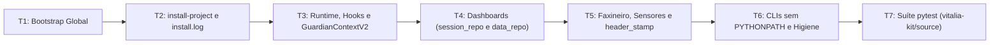

<!-- mapa-testes-vitalia-kit.md | Vitalia Kit v0.0.1 | 27-11-2026 10:36(GMT-04:00) -->
**mapa-testes-vitalia-kit.md | Vitalia Kit v0.0.1 | 27-11-2026 10:36(GMT-04:00)**

# Mapa de Testes Repetíveis — Vitalia Kit v0.0.1+

> **Propósito:** Roteiro canônico e repetível de validação end-to-end do **Vitalia Kit** entre rodadas de correção (Rodada 1, Rodada 2, Rodada 3, ...), garantindo que nenhuma regressão passe despercebida e que cada critério de aceitação seja verificado com evidência real em sandbox isolado (`/tmp/`).

---

## Visão Geral do Ciclo de Validação

---

## Matriz de Suítes e Critérios de Aceitação

### T1 — Instalação Global (`source/kit-bootstrap.sh`)
| ID | Caso de Teste | Comando / Verificação | Critério de Sucesso (PASS) |
|---|---|---|---|
| **T1.1** | Execução isolada | `HOME=/tmp/vitalia-fakehome bash ./kit-bootstrap.sh --kit-dir /tmp/vitalia-fakehome/.vitalia-kit --yes --verbose` | `exit 0`; passos claros exibidos no terminal (`--verbose` honrado). |
| **T1.2** | Log persistente global | Verificar `<kit_dir>/logs/install.log` em 2 execuções seguidas | Arquivo criado com timestamp `GMT-04:00` e histórico preservado (append/rotação) entre execuções. |
| **T1.3** | Ordem `${KIT_PYTHON}`, Shell RC e Marca | Inspecionar `kit-bootstrap.sh` e `~/.bashrc`/`~/.zshrc` do `HOME` isolado | Nenhum `python3` do sistema antes do `.venv`; `VITALIA_KIT_DIR` e `PATH` configurados; identidade `"Vitalia Kit"` (sem `"Vitalia SPEC Kit"`). |

---

### T2 — Instalação no Projeto (`bin/install-project`) e `install.log`
| ID | Caso de Teste | Comando / Verificação | Critério de Sucesso (PASS) |
|---|---|---|---|
| **T2.1** | Instalação limpa em projeto alvo | `<HOME>/.vitalia-kit/bin/install-project --project-dir /tmp/vitalia-test-rN --yes` | `exit 0`; 34+ skills materializadas; `.agents/AGENTS.md` e manifesto SHA-256 gerados. |
| **T2.2** | **Selo de Data/Hora e Append em `install.log`** | Executar `install-project` **2 vezes** no mesmo diretório e inspecionar `install.log` | Cada execução registra data/hora (`DD-MM-YYYY HH:MM:SS(GMT-04:00)`) e **não apaga** os logs da tentativa anterior (append com separador de execução). |
| **T2.3** | Localização do `install.log` | Verificar `.vitalia/install.log` e `.vitalia/memory/data_storage/telemetry/install.log` | Log acessível para diagnóstico do projeto e/ou telemetria na Camada 3 sem sobrescrita destrutiva. |
| **T2.4** | Artefatos iniciais e `.gitignore` | Inspecionar `.vitalia/config.yml`, `feature.json`, `extensions.yml`, `session_ledger.json`, `.gitignore` | `config.yml` completo (`kit_version`, `kit_dir`, `project`, `domain_gates`, `memory`/`storage`); `feature.json`, `extensions.yml` e `session_ledger.json` criados; `.gitignore` protege `.env`, `.vitalia/config.yml`, `.vitalia/memory/`, `.vitalia/backups/`. |
| **T2.5** | Reconciliação Git (`git_storage_manager.sh`) | Testar com repositórios remotos populados (`git ls-remote` / `fetch`) e re-execução com nova URL | Sem commit órfão conflitante quando o remoto já tem `main`; atualiza `origin` quando `.git` já existe. |
| **T2.6** | Prompts interativos (`NON_INTERACTIVE=0`) | Inspecionar/simular `install-project` sem `--yes` e sem `--session-repo`/`--data-repo` | Solicita `SESSION_REPO` e `DATA_REPO` interativamente (Enter aceita modo local). |

---

### T3 — Runtime, Hooks, `GuardianContextV2` e Contratos
| ID | Caso de Teste | Comando / Verificação | Critério de Sucesso (PASS) |
|---|---|---|---|
| **T3.1** | Bootstrap do ambiente | `${KIT_PYTHON} ${KIT_DIR}/src/kit_env_bootstrap.py --cwd /tmp/vitalia-test-rN --json` | `exit 0`, `"status": "HEALTHY"`. |
| **T3.2** | Hook `before` + Indexação | `${KIT_PYTHON} ${KIT_DIR}/src/vitalia_hook_runner.py ${KIT_DIR}/extensions/session-start.toml --phase before --args=""` | Envelope gravado em `.vitalia/memory/data_storage/context/<machine_id>/` e registrado em `context/index.jsonl`. |
| **T3.3** | `GuardianContextV2` (`phase_guardrails` / `phase_profiles`) | Inspecionar `guardian_json` do envelope gerado por `brainstorming.toml` ou `spec-plan.toml` | `phase_guardrails` e `phase_profiles` populados (não `{}`) quando o `gp_*.yaml` define regras/papel. |
| **T3.4** | Constituição (`profiles/constitution.yaml`) | Inspecionar `P04`, `P07`, `P10`, `P12`, `P16` | `P04` inclui formato completo de 2 linhas para `.md`; nenhum `validator:` aponta para `hooks/llm_judge.py` inexistente. |
| **T3.5** | Contratos `extensions/*.toml` | Auditar `transport.file_path`, tamanho de `guardian.prompt` e cláusula P03 | `transport.file_path` unificado em 100% dos `.toml`; prompts com instruções operacionais completas (não comprimidos em 1 linha); `science-review.toml` e `integrative-review.toml` com papel de revisor + `vitalia-researcher`. |

---

### T4 — Dashboards de Nuvem (`session_repo` e `data_repo`) e Motor de Contexto
| ID | Caso de Teste | Comando / Verificação | Critério de Sucesso (PASS) |
|---|---|---|---|
| **T4.1** | Consolidação `session_repo` (local e links) | `${KIT_PYTHON} ${KIT_DIR}/src/vitalia_context_engine.py --action consolidate --cwd /tmp/vitalia-test-rN` | Grava em `.vitalia/memory/session/README.md` (nunca `.vitalia/session/`); contagens reais; zero links `file:///`. |
| **T4.2** | **Riqueza Visual e Dados de Sessão (`session_repo/README.md`)** | Inspecionar `.vitalia/memory/session/README.md` | Apresenta painel visual rico (header, badges, status da sessão, shards de `session_ledger.json`, decisões de `decisions.jsonl`, aprendizados de `learnings.jsonl`, telemetria da Camada 3 e navegação relativa). Não é apenas uma tabela rudimentar de contagens. |
| **T4.3** | Execução direta `data_storage_dashboard_renderer.py` | `${KIT_PYTHON} ${KIT_DIR}/src/rendering/data_storage_dashboard_renderer.py --storage-dir /tmp/vitalia-test-rN/.vitalia/memory/data_storage` | `exit 0` **sem** `PYTHONPATH` manual; grava `README.md` Nível 0 e Nível 1 nas categorias; links relativos válidos no GitHub. |
| **T4.4** | **Riqueza Visual e Dados de Storage (`data_repo/README.md`)** | Inspecionar `.vitalia/memory/data_storage/README.md` e subpainéis Nível 1 | Apresenta painel visual rico com métricas, estado dos índices (`index.jsonl`), resumos por categoria e navegação Nível 0 ↔ Nível 1 ↔ Nível 2. |
| **T4.5** | Flags CLI do Motor de Contexto | Testar `--action end --payload-file ...`, `--action list-pending-domains --json`, `--action consolidate`, `--render-session-dashboard`, `--render-data-dashboard`, `--render-grounding` | Todas as flags contratuais (`--action {end,list-pending-domains,consolidate}`) existem e respondem com `exit 0` (sem `unrecognized arguments`). |

---

### T5 — Faxineiro (`vitalia-clean`), Sensores VRSS e `header_stamp.py`
| ID | Caso de Teste | Comando / Verificação | Critério de Sucesso (PASS) |
|---|---|---|---|
| **T5.1** | `vitalia-clean` / `vitalia_tmp_cleanup.py` | `${KIT_DIR}/bin/vitalia-clean --cwd /tmp/vitalia-test-rN --dry-run` | `exit 0` sem `PYTHONPATH` manual; lê `.vitalia/memory/data_storage/context/` (sem apontar para `.vitalia/session/data/`). |
| **T5.2** | `sensor_memory_ledger.py` | `${KIT_PYTHON} ${KIT_DIR}/src/sensors/sensor_memory_ledger.py --memory-dir /tmp/vitalia-test-rN/.vitalia/memory --json` | `exit 0`, `"status": "PASS"` mesmo em projeto recém-instalado. |
| **T5.3** | Demais sensores VRSS | Executar `sensor_tokens_leak.py`, `sensor_path_hygiene.py`, `sensor_purity.py` | Todos `exit 0` / `PASS`. |
| **T5.4** | `maintenance/header_stamp.py` | `${KIT_PYTHON} ${KIT_DIR}/src/maintenance/header_stamp.py --help` e execução em `.md`/`.py`/`.json` de teste | `exit 0`; usa `Vitalia Kit v{VERSION}`; 2ª linha `.md` em `**...**` sem `> `; `.json` validado apenas sintaticamente (`json.loads`). |
| **T5.5** | `pre_commit_runner.py` | Inspecionar caminho do Python gerado no hook pre-commit | Referencia `$HOME/.vitalia-kit/.venv/bin/python3` (zero referências a `.vitalia-spec-kit`). |

---

### T6 — Execução Direta de CLIs (P10) e Higiene de Referências Legadas
| ID | Caso de Teste | Comando / Verificação | Critério de Sucesso (PASS) |
|---|---|---|---|
| **T6.1** | `--help` sem `PYTHONPATH` | Executar `${KIT_PYTHON} <script> --help` para todos os CLIs em `src/` | 100% `exit 0` sem `ModuleNotFoundError`. |
| **T6.2** | Varredura de legado | `rg` em `${KIT_DIR}` por `vitalia-spec-kit`, `Vitalia SPEC Kit`, `session/data` (`memory/session/data`, `.vitalia/session/data`) | Zero ocorrências ativas em código/templates/configs. |

---

### T7 — Suíte Automatizada (`pytest` em `vitalia-kit/source`)
| ID | Caso de Teste | Comando / Verificação | Critério de Sucesso (PASS) |
|---|---|---|---|
| **T7.1** | Testes unitários e de integração | `${KIT_PYTHON} -m pytest <REPO_ROOT>/source/tests/` | 100% dos testes passando sem skips ou caminhos legados. |

---

### T8 — Portão P03, Pipeline do `vitalia-researcher` & Fluxo 1A
| ID | Caso de Teste | Comando / Verificação | Critério de Sucesso (PASS) |
|---|---|---|---|
| **T8.1** | Contrato canônico `evidence_record` + `--evidence-dir` | `${KIT_PYTHON} ${KIT_DIR}/src/vitalia_grounding_validator.py --mode evidence --evidence-dir <tema_dir> --strict` | `exit 0`; valida cada linha contra `evidence_record.schema.json`; bloqueia `http_status != 200`, `status: "unverified"` ou `literal_quote` ausente do snapshot. |
| **T8.2** | Renderização `GROUNDING_AUDIT.md` sem `file://` | `${KIT_PYTHON} ${KIT_DIR}/src/rendering/grounding_audit_renderer.py --evidence-dir <tema_dir>` | `exit 0`; zero links `file://` e zero placeholders crus (`{topic}`, `{timestamp}`); emite links relativos (`./snapshots/<sha>.txt`, `./evidence.jsonl`, `../README.md`). |
| **T8.3** | Fluxo 1A ponta-a-ponta (`general_web` → `grounding_domains.yaml`) | Simular `evidence.jsonl` com `domain_match: "general_web"` → `list-pending-domains --json` → `consolidate --update-grounding-domains --grounding-decisions-file ...` | `list-pending-domains` lista o domínio pendente; após consolidação HITL, domínio é promovido/registrado e nova execução retorna `0` pendentes (sem regressão em `grounding-domains.jsonl`). |
| **T8.4** | Paridade de Schemas P11 (`36/36`) e `latest_handoff` | `${KIT_PYTHON} -m pytest source/tests/test_schemas_openapi30_p11.py` | 100% dos **36 schemas** válidos sob OpenAPI 3.0.3 Limpo (P11); `latest_handoff()` ignora handoffs expirados ou com `"$schema"`. |

---

## Histórico de Execuções

| Rodada | Data (GMT-04:00) | Versão Kit | Resultado Resumido | Relatório |
|---|---|---|---|---|
| **Rodada 1** | 23-11-2026 | `v0.0.1` | ❌ Falhas críticas (A1–A8, B1–B9, C1–C5, D1–D5) | [relatorio-completo-testes-e-erros-turno-1.md](./relatorio-completo-testes-e-erros-turno-1.md) |
| **Rodada 2** | 24-11-2026 | `v0.0.1` | ⚠️ Parcial (`install.log` sem data/hora e sobrescreve; dashboards rudimentares; D2/D3/D4/D5 e C3/C5 abertos) | [relatorio-rodada-2-vitalia-kit.md](./relatorio-rodada-2-vitalia-kit.md) |
| **Rodada 3** | 25-11-2026 | `v0.0.1` | ✅ PASS (Spec 007 / `48c9eac`: `202/202` `pytest`, `68/68` `--check`, `25/25` CLIs, `2× install-project` append `GMT-04:00`, docs sincronizados) | [relatorio-rodada-3-vitalia-kit.md](./relatorio-rodada-3-vitalia-kit.md) |

---

## Atualização Rodada 3 (Spec 007 — `T2.4`, `T3.5`, `T4.4`, `T4.5`, `T5.4`, `T6.2`, `T7.1`)
- **T2.4 (`.gitignore`):** Validar presença de `.env`, `.vitalia/config.yml`, `.vitalia/memory/`, `.vitalia/backups/`, `.vitalia/install.log`, `.vitalia/end_payload.json`, `.vitalia/grounding_decisions_payload.json` e `.vitalia/*.tmp`.
- **T3.5 (34 `.toml`):** Confirmar ausência de `file_path` em `[transport]`, prompts completos afirmativos (ADR-0003) + P03 (`vitalia-researcher`), `reviews/` + `gp_research` em revisões científicas.
- **T4.4 / T4.5 (`vitalia_context_engine.py`):** Validar `--action {end,list-pending-domains,consolidate}`, `--payload-file`, `--kit-dir`, `--render-session-dashboard`, `--render-data-dashboard`, `--render-grounding`, `--update-grounding-domains` e preservação de `data_storage/README.md` Nível 0/1.
- **T5.4 (`header_stamp.py`):** Validar `--cwd`, `--json` (`finding.schema.json`) e auditoria *read-only* de `.json`.
- **T7.1 (`pytest`):** Executar a partir da raiz do repositório e de `source/` sem dependência de CWD fixo.
